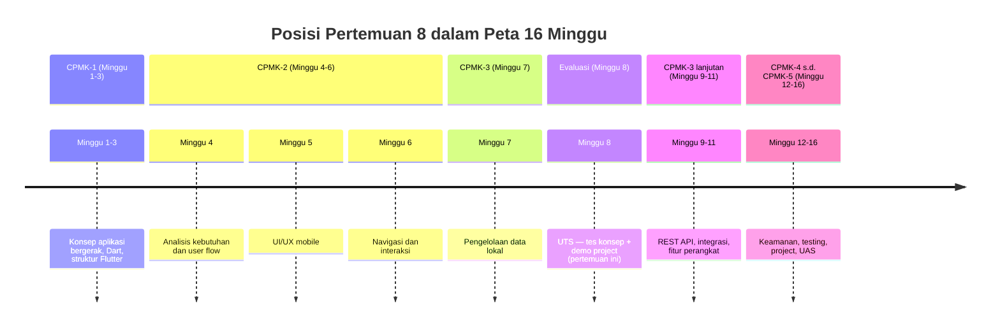
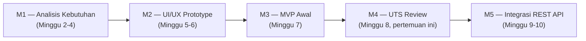
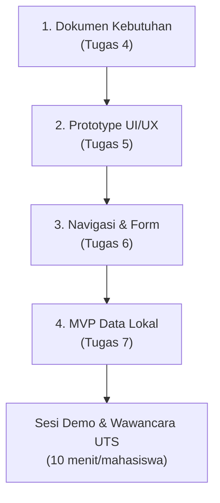
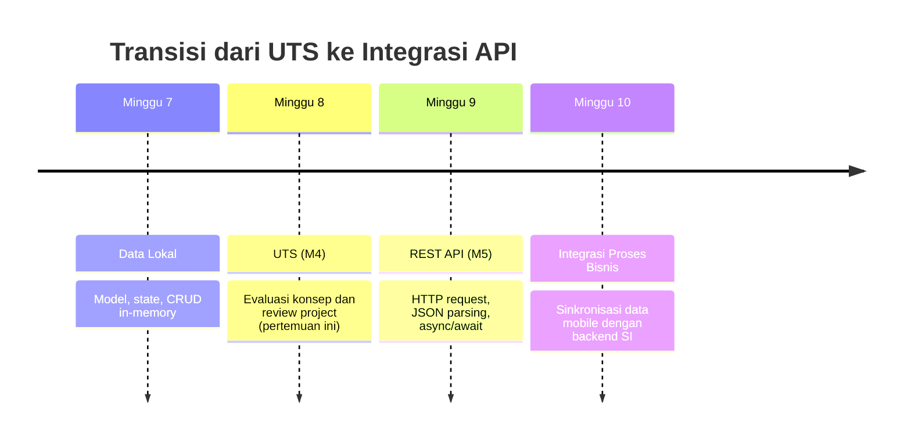

# Pertemuan 8 — UTS: Evaluasi Tengah Semester

| | |
|:--|:--|
| **Minggu** | 8 |
| **Tanggal** | Rabu, 4 November 2026 (SI-VIIB) / Sabtu, 7 November 2026 (SI-VIIA) |
| **CPMK** | CPMK-1 s.d. CPMK-3 |
| **Model Pembelajaran** | Project Based Learning — evaluasi |
| **Stack** | Flutter + Dart (seluruh materi Pertemuan 1–7) |
| **Milestone** | M4 — UTS: Project Review |

> **Catatan penting:** Pertemuan 8 adalah **Ujian Tengah Semester (UTS)** — evaluasi pemahaman konsep dan progress implementasi project hingga Minggu 7. UTS terdiri atas dua komponen: **Tes Konsep** (10 soal esai yang dijawab pada file `tes-konsep-uts.md` dan di-push ke repository) dan **Evaluasi Progress Project** (demo MVP awal beserta dokumen kebutuhan, prototype, dan kode). Kedua komponen mengevaluasi capaian CPMK-1 (konsep aplikasi bergerak), CPMK-2 (analisis kebutuhan dan UI/UX), dan CPMK-3 (implementasi data lokal).
>
> **Batas cakupan:** Materi yang diuji mencakup Pertemuan 1–7: konsep aplikasi bergerak dalam SI, dasar Dart, struktur Flutter dan widget, analisis kebutuhan dan user flow, UI/UX mobile, navigasi dan interaksi, serta pengelolaan data lokal (model, state, CRUD, persistensi dasar). Materi Pertemuan 9 dan seterusnya (REST API, fitur perangkat, keamanan, testing) **tidak termasuk** cakupan UTS.

---

## Daftar Isi

- [Pertemuan 8 — UTS: Evaluasi Tengah Semester](#pertemuan-8--uts-evaluasi-tengah-semester)
  - [Daftar Isi](#daftar-isi)
  - [1. Keterkaitan Pertemuan dengan RPS OBE](#1-keterkaitan-pertemuan-dengan-rps-obe)
  - [2. Capaian Pembelajaran UTS](#2-capaian-pembelajaran-uts)
  - [3. Format UTS](#3-format-uts)
    - [Ketentuan Tes Konsep](#ketentuan-tes-konsep)
    - [Ketentuan Evaluasi Progress Project](#ketentuan-evaluasi-progress-project)
  - [4. Kisi-Kisi Tes Konsep](#4-kisi-kisi-tes-konsep)
  - [5. Tes Konsep UTS — Soal Esai](#5-tes-konsep-uts--soal-esai)
    - [Soal 1 — Konsep Aplikasi Bergerak dalam SI (CPMK-1)](#soal-1--konsep-aplikasi-bergerak-dalam-si-cpmk-1)
    - [Soal 2 — Dasar Pemrograman Dart (CPMK-1)](#soal-2--dasar-pemrograman-dart-cpmk-1)
    - [Soal 3 — Struktur Flutter dan Widget (CPMK-1)](#soal-3--struktur-flutter-dan-widget-cpmk-1)
    - [Soal 4 — Analisis Kebutuhan dan User Flow (CPMK-2)](#soal-4--analisis-kebutuhan-dan-user-flow-cpmk-2)
    - [Soal 5 — UI/UX Mobile (CPMK-2)](#soal-5--uiux-mobile-cpmk-2)
    - [Soal 6 — Navigasi dan Interaksi (CPMK-2)](#soal-6--navigasi-dan-interaksi-cpmk-2)
    - [Soal 7 — Model Data dan State (CPMK-3)](#soal-7--model-data-dan-state-cpmk-3)
    - [Soal 8 — CRUD Lokal (CPMK-3)](#soal-8--crud-lokal-cpmk-3)
    - [Soal 9 — Persistensi Data Lokal (CPMK-3)](#soal-9--persistensi-data-lokal-cpmk-3)
    - [Soal 10 — Integrasi Konsep Lintas Pertemuan (CPMK-1 s.d. CPMK-3)](#soal-10--integrasi-konsep-lintas-pertemuan-cpmk-1-sd-cpmk-3)
  - [6. Evaluasi Progress Project](#6-evaluasi-progress-project)
    - [6.1 Artefak yang Wajib Tersedia](#61-artefak-yang-wajib-tersedia)
    - [6.2 Alur Sesi Evaluasi (10 Menit/Mahasiswa)](#62-alur-sesi-evaluasi-10-menitmahasiswa)
    - [Cara Pengumpulan — Push ke Repository GitHub Kelas](#cara-pengumpulan--push-ke-repository-github-kelas)
  - [7. Rubrik Penilaian UTS](#7-rubrik-penilaian-uts)
    - [7.1 Rubrik Tes Konsep (Bobot 40%)](#71-rubrik-tes-konsep-bobot-40)
    - [7.2 Rubrik Evaluasi Progress Project (Bobot 60%)](#72-rubrik-evaluasi-progress-project-bobot-60)
  - [8. Template Laporan Progress Project](#8-template-laporan-progress-project)
  - [9. Pemanfaatan AI sebagai Coding Assistant](#9-pemanfaatan-ai-sebagai-coding-assistant)
  - [10. Persiapan ke Pertemuan 9](#10-persiapan-ke-pertemuan-9)

---

## 1. Keterkaitan Pertemuan dengan RPS OBE

Pertemuan 8 mengevaluasi capaian **CPMK-1 s.d. CPMK-3** yang dipelajari selama Minggu 1–7. Evaluasi dilakukan melalui dua komponen yang saling melengkapi: tes konsep untuk mengukur pemahaman, dan demo project untuk mengukur kemampuan implementasi.



Keterkaitan dengan milestone: pertemuan ini adalah **M4 — UTS: Project Review**. Deliverable yang dievaluasi meliputi dokumen kebutuhan (M1), prototype UI/UX (M2), dan MVP awal (M3) yang telah dibangun pada Minggu 1–7.



---

## 2. Capaian Pembelajaran UTS

Setelah menyelesaikan UTS, mahasiswa mampu menunjukkan:

| No. | Kemampuan (CPMK) | Indikator | Komponen UTS |
|:---:|:-----------------|:----------|:-------------|
| 1 | Menjelaskan konsep aplikasi bergerak dalam konteks SI (CPMK-1) | Menjelaskan karakteristik mobile, arsitektur client–server, dan alasan penggunaan aplikasi mobile untuk domain SI | Tes Konsep |
| 2 | Menerapkan dasar pemrograman Dart (CPMK-1) | Menjelaskan variabel, tipe data, kontrol alur, fungsi, dan koleksi yang digunakan pada kode project | Tes Konsep |
| 3 | Menjelaskan struktur Flutter dan widget (CPMK-1) | Menjelaskan `MaterialApp`, `Scaffold`, widget tree, dan layout yang digunakan pada project | Tes Konsep |
| 4 | Menganalisis kebutuhan dan user flow (CPMK-2) | Menyusun dokumen kebutuhan fungsional/nonfungsional, prioritas MoSCoW, dan user flow | Evaluasi Project |
| 5 | Merancang UI/UX mobile (CPMK-2) | Menyusun prototype UI/UX, navigation flow, dan implementasi visual | Evaluasi Project |
| 6 | Mengimplementasikan navigasi dan interaksi (CPMK-2) | Menghubungkan halaman dengan `Navigator`, form dengan validasi, dan feedback pengguna | Evaluasi Project |
| 7 | Mengelola data lokal (CPMK-3) | Menyusun model data, mengelola state dengan `setState`, dan melakukan CRUD lokal | Evaluasi Project |
| 8 | Menjelaskan keputusan teknis project (CPMK-1 s.d. CPMK-3) | Menjelaskan alasan setiap keputusan: field model, operasi CRUD, navigasi, dan pilihan UI/UX | Tes Konsep + Demo |

---

## 3. Format UTS

UTS terdiri atas dua komponen dengan bobot berbeda:

| Komponen | Bobot | Durasi | Bentuk | Cakupan |
|:---------|:-----:|:-------|:-------|:--------|
| **Tes Konsep** | 40% | Mandiri sebelum tenggat push | 10 soal esai (HOTS / studi kasus) dalam file `tes-konsep-uts.md` | Pertemuan 1–7 |
| **Evaluasi Progress Project** | 60% | Demo 10 menit/mahasiswa | Demo MVP + dokumen + kode | M1–M3 (Minggu 1–7) |
| **Total** | **100%** | — | — | — |

### Ketentuan Tes Konsep

- Soal bersifat **esai analitis** — bukan pilihan ganda. Setiap soal menuntut penjelasan alasan, bukan sekadar menyebut istilah.
- Soal dirancang berdasarkan **studi kasus domain SI** — mahasiswa menerapkan konsep pada situasi nyata, bukan menghafal definisi.
- Jawaban tes konsep ditulis pada file **`tes-konsep-uts.md`** di folder `tugas-8/` dan di-push ke repository — tes konsep dikerjakan secara mandiri, bukan di dalam kelas.
- **Tidak boleh membuka catatan, kode, atau referensi; AI, peramban, dan perangkat lain tidak digunakan** selama pengerjaan tes konsep.

> **SOAL WAJIB DIKERJAKAN:** Jawab **semua Soal 1–10** pada Bagian 5. Tidak ada soal pilihan atau soal tambahan; setiap soal memiliki bobot yang sama.

| Bagian | Status pengerjaan | Bobot |
|:-------|:------------------|:-----:|
| Soal 1 — Konsep aplikasi bergerak dalam SI | **Wajib dijawab** | 10% dari Tes Konsep |
| Soal 2 — Dasar pemrograman Dart | **Wajib dijawab** | 10% dari Tes Konsep |
| Soal 3 — Struktur Flutter dan widget | **Wajib dijawab** | 10% dari Tes Konsep |
| Soal 4 — Analisis kebutuhan dan user flow | **Wajib dijawab** | 10% dari Tes Konsep |
| Soal 5 — UI/UX mobile | **Wajib dijawab** | 10% dari Tes Konsep |
| Soal 6 — Navigasi dan interaksi | **Wajib dijawab** | 10% dari Tes Konsep |
| Soal 7 — Model data dan state | **Wajib dijawab** | 10% dari Tes Konsep |
| Soal 8 — CRUD lokal | **Wajib dijawab** | 10% dari Tes Konsep |
| Soal 9 — Persistensi data lokal | **Wajib dijawab** | 10% dari Tes Konsep |
| Soal 10 — Integrasi konsep lintas pertemuan | **Wajib dijawab** | 10% dari Tes Konsep |

### Ketentuan Evaluasi Progress Project

- Mahasiswa mendemokan **MVP awal** yang telah di-push ke repository GitHub kelas (Tugas 1–7).
- Dokumen yang wajib tersedia: dokumen kebutuhan (Tugas 4), prototype UI/UX (Tugas 5), navigation flow (Tugas 6), dan kode CRUD lokal (Tugas 7).
- Demo mengikuti **user flow** yang telah dirancang — dari halaman utama hingga operasi CRUD.
- Dosen mengajukan pertanyaan klarifikasi selama demo untuk memverifikasi pemahaman.

> **ARTEFAK WAJIB:** Siapkan seluruh dokumen, prototype, kode, dan laporan progress pada [Bagian 6.1](#61-artefak-yang-wajib-tersedia). Project tetap harus didemonstrasikan meskipun terdapat fitur yang belum selesai; tandai statusnya sebagai **Selesai** atau **Sebagian** pada laporan.

---

## 4. Kisi-Kisi Tes Konsep

Kisi-kisi memetakan cakupan materi ke jumlah soal dan tingkat kognitif (taksonomi Bloom revisi):

| No. | Cakupan Materi | Pertemuan | CPMK | Jumlah Soal | Tingkat Kognitif |
|:---:|:---------------|:---------:|:----:|:------------:|:-----------------|
| 1 | Konsep aplikasi bergerak dalam SI | 1 | CPMK-1 | 1 | Analisis |
| 2 | Dasar pemrograman Dart | 2 | CPMK-1 | 1 | Penerapan |
| 3 | Struktur Flutter dan widget | 3 | CPMK-1 | 1 | Analisis |
| 4 | Analisis kebutuhan dan user flow | 4 | CPMK-2 | 1 | Evaluasi |
| 5 | UI/UX mobile | 5 | CPMK-2 | 1 | Evaluasi |
| 6 | Navigasi dan interaksi | 6 | CPMK-2 | 1 | Penerapan |
| 7 | Model data dan state | 7 | CPMK-3 | 1 | Analisis |
| 8 | CRUD lokal | 7 | CPMK-3 | 1 | Penerapan |
| 9 | Persistensi data lokal | 7 | CPMK-3 | 1 | Analisis |
| 10 | Integrasi konsep (lintas pertemuan) | 1–7 | CPMK-1 s.d. CPMK-3 | 1 | Mencipta |
| | **Total** | | | **10** | |

> Soal nomor 10 bersifat **integratif** — mahasiswa diminta merancang solusi lengkap untuk studi kasus yang menggabungkan konsep dari beberapa pertemuan. Soal ini mengukur kemampuan menyintesis pengetahuan, bukan sekadar mengingat.

---

## 5. Tes Konsep UTS — Soal Esai

**Petunjuk:** Jawab seluruh soal berikut pada file `tes-konsep-uts.md` di folder `tugas-8/` repository kelas Anda. Setiap jawaban harus menyertakan **alasan** — bukan sekadar menyebut istilah atau kode. Soal dirancang berdasarkan studi kasus domain SI. Pengerjaan tes konsep bersifat mandiri dan di-push bersamaan dengan artefak project pada [Bagian 6](#cara-pengumpulan--push-ke-repository-github-kelas).

> **PENANDA PENGERJAAN:** Semua soal di bawah ini, yaitu **Soal 1 sampai Soal 10, wajib dikerjakan**.

---

### Soal 1 — Konsep Aplikasi Bergerak dalam SI (CPMK-1)

Sebuah kampus ingin mengembangkan aplikasi mobile untuk layanan pengajuan surat keterangan mahasiswa. Saat ini, mahasiswa harus datang ke loket administrasi untuk mengambil formulir, mengisi secara manual, dan menunggu antrian. Jelaskan **tiga karakteristik aplikasi bergerak** yang menjadikan solusi mobile lebih tepat dibandingkan aplikasi web desktop untuk kebutuhan ini. Untuk setiap karakteristik, berikan contoh penerapan pada kasus pengajuan surat.

---

### Soal 2 — Dasar Pemrograman Dart (CPMK-1)

Berikut adalah potongan kode Dart untuk menyimpan daftar surat:

```dart
List<String> daftarSurat = [];

void tambahSurat(String jenis) {
  if (jenis.isEmpty) {
    print('Jenis surat tidak boleh kosong');
    return;
  }
  daftarSurat.add(jenis);
}

void tampilkanSurat() {
  for (int i = 0; i < daftarSurat.length; i++) {
    print('${i + 1}. ${daftarSurat[i]}');
  }
}
```

Jelaskan **fungsi setiap bagian** kode di atas: `List<String>`, parameter `String jenis`, `isEmpty`, `return` pada kondisi error, `add`, dan perulangan `for`. Kemudian jelaskan **satu kesalahan umum** yang dapat terjadi bila validasi `isEmpty` dihapus.

---

### Soal 3 — Struktur Flutter dan Widget (CPMK-1)

Seorang mahasiswa membuat halaman daftar surat dengan struktur widget berikut:

```dart
MaterialApp(
  home: Scaffold(
    appBar: AppBar(title: Text('Daftar Surat')),
    body: Column(
      children: [
        Text('Pilih jenis surat'),
        ListView.builder(...),
      ],
    ),
  ),
)
```

Jelaskan **fungsi setiap widget** (`MaterialApp`, `Scaffold`, `AppBar`, `Column`, `Text`, `ListView.builder`) dalam struktur di atas. Kemudian jelaskan **satu masalah** yang dapat terjadi bila `ListView.builder` ditempatkan langsung di dalam `Column` tanpa `Expanded` — apa penyebabnya dan bagaimana memperbaikinya?

---

### Soal 4 — Analisis Kebutuhan dan User Flow (CPMK-2)

Berikut adalah tiga permintaan dari mahasiswa untuk aplikasi pengajuan surat:

1. "Saya ingin mengajukan surat keterangan aktif kuliah."
2. "Saya ingin melihat status pengajuan saya."
3. "Saya ingin menerima notifikasi saat surat siap diambil."

Pisahkan ketiga permintaan tersebut menjadi **kebutuhan fungsional** dan **kebutuhan nonfungsional**. Kemudian tentukan prioritas **MoSCoW** (Must / Should / Could / Won't) untuk setiap kebutuhan dan jelaskan alasan prioritas tersebut. Susun **user flow** sederhana (dalam bentuk daftar langkah) untuk kebutuhan *Must*.

---

### Soal 5 — UI/UX Mobile (CPMK-2)

Aplikasi pengajuan surat memiliki halaman daftar yang menampilkan 20 jenis surat. Setiap item menampilkan nama surat, status, dan tombol ajukan. Jelaskan **tiga prinsip UI/UX mobile** yang perlu diperhatikan pada halaman daftar ini. Untuk setiap prinsip, jelaskan **keputusan desain** yang Anda ambil dan **alasannya**. Pertimbangkan: ukuran layar, interaksi sentuh, dan sesi penggunaan singkat.

---

### Soal 6 — Navigasi dan Interaksi (CPMK-2)

Aplikasi pengajuan surat memiliki tiga halaman: daftar surat, form pengajuan, dan detail status. Jelaskan bagaimana Anda mengimplementasikan **navigasi antar ketiga halaman** menggunakan `Navigator` — sebutkan metode yang digunakan (`push`, `pushNamed`, `pop`) dan kapan masing-masing digunakan. Kemudian jelaskan bagaimana **data jenis surat** dikirim dari halaman daftar ke halaman form, dan bagaimana **feedback** diberikan setelah form dikirim.

---

### Soal 7 — Model Data dan State (CPMK-3)

Berikut adalah model data untuk pengajuan surat:

```dart
class PengajuanSurat {
  const PengajuanSurat({
    required this.id,
    required this.jenis,
    required this.tanggal,
    required this.status,
  });

  final String id;
  final String jenis;
  final String tanggal;
  final String status;
}
```

Jelaskan **mengapa setiap field bersifat `final`** dan **mengapa `id` wajib ada**. Kemudian jelaskan perbedaan antara `StatelessWidget` dan `StatefulWidget` — mana yang digunakan untuk halaman daftar pengajuan dan **mengapa**. Terakhir, jelaskan **fungsi `setState`** dan apa yang terjadi bila data ditambah tanpa `setState`.

---

### Soal 8 — CRUD Lokal (CPMK-3)

Seorang mahasiswa mengimplementasikan operasi CRUD untuk pengajuan surat. Jelaskan **empat operasi CRUD** (Create, Read, Update, Delete) beserta **method `List`** yang digunakan untuk setiap operasi pada Flutter. Kemudian jelaskan **mengapa `id` digunakan sebagai kunci** operasi update dan delete, bukan index daftar — apa konsekuensinya bila index digunakan sebagai kunci?

---

### Soal 9 — Persistensi Data Lokal (CPMK-3)

Aplikasi pengajuan surat menyimpan data secara in-memory menggunakan `List<PengajuanSurat>` pada state. Jelaskan **perbedaan penyimpanan in-memory dengan persistensi** menggunakan package `shared_preferences`. Mengapa operasi `shared_preferences` bersifat **asinkron** (`Future`), dan apa yang terjadi bila kata kunci `await` diabaikan saat menyimpan data? Berikan contoh situasi di mana in-memory sudah cukup dan situasi di mana persistensi mutlak diperlukan.

---

### Soal 10 — Integrasi Konsep Lintas Pertemuan (CPMK-1 s.d. CPMK-3)

Sebuah unit perpustakaan kampus ingin membuat aplikasi mobile peminjaman buku. Rancang solusi aplikasi mobile yang mengintegrasikan konsep dari Pertemuan 1–7 dengan menjawab empat poin berikut:

1. **Arsitektur:** Gambarkan atau jelaskan hubungan antara aplikasi mobile, penyimpanan lokal, dan backend Sistem Informasi.
2. **Kebutuhan & Alur:** Tentukan dua kebutuhan *Must have* dan susun alur pengguna dari membuka aplikasi hingga tugas selesai.
3. **Struktur Komponen:** Sebutkan struktur widget utama (halaman katalog, halaman form peminjaman) dan bagaimana navigasi antarhalaman dilakukan.
4. **Data & State:** Tuliskan definisi model data `Buku` (minimal 4 field) dan jelaskan bagaimana operasi Create (meminjam) dan Read (melihat riwayat) dikelola dalam state aplikasi.

---

## 6. Evaluasi Progress Project

Evaluasi progress project adalah penilaian langsung terhadap produk yang telah dibangun oleh mahasiswa selama Minggu 1–7. Evaluasi ini mencakup empat artefak utama:



### 6.1 Artefak yang Wajib Tersedia

Setiap mahasiswa wajib memastikan artefak berikut telah berada pada repository GitHub kelas sebelum sesi evaluasi dimulai:

| No. | Artefak | Sumber Tugas | Deskripsi Minimal |
|:---:|:--------|:-------------|:------------------|
| 1 | Dokumen kebutuhan + user flow | Tugas 4 | Minimal 1 persona, tabel kebutuhan fungsional/nonfungsional berprioritas MoSCoW, dan diagram user flow |
| 2 | Prototype UI/UX | Tugas 5 | Wireframe/layout halaman utama dan halaman detail/form, catatan keputusan desain |
| 3 | Navigasi dan interaksi | Tugas 6 | Minimal 2 halaman terhubung dengan `Navigator`, form dengan validasi, feedback `SnackBar` |
| 4 | MVP data lokal (CRUD) | Tugas 7 | Model data dengan field tertelusur ke kebutuhan, `StatefulWidget`, operasi Create, Read, Update, Delete yang berfungsi |
| 5 | Jawaban Tes Konsep | UTS (M4) | File `tes-konsep-uts.md` berisi jawaban seluruh Soal 1–10 pada [Bagian 5](#5-tes-konsep-uts--soal-esai) |
| 6 | Laporan progress project | UTS (M4) | Dokumen ringkasan kemajuan project mengikuti template pada [Bagian 8](#8-template-laporan-progress-project) |

### 6.2 Alur Sesi Evaluasi (10 Menit/Mahasiswa)

1. **Menjalankan aplikasi (1 menit):** Mahasiswa menjalankan aplikasi melalui DartPad atau Flutter SDK (target web/Chrome).
2. **Demonstrasi user flow (4 menit):** Mahasiswa mendemokan alur utama aplikasi sesuai rancangan: membuka katalog/daftar, membuka form, mengisi data, memvalidasi input, menyimpan data, melihat pembaruan pada daftar, mengubah status/data, dan menghapus data dengan konfirmasi.
3. **Wawancara dan klarifikasi kode (3 menit):** Dosen mengajukan pertanyaan acak seputar kode dan keputusan teknis project untuk memverifikasi pemahaman mandiri mahasiswa.
4. **Pemberian feedback dan tindak lanjut (2 menit):** Dosen menyampaikan catatan perbaikan yang wajib ditindaklanjuti untuk persiapan Milestone M5 (integrasi REST API pada Minggu 9).

### Cara Pengumpulan — Push ke Repository GitHub Kelas

UTS dikumpulkan melalui repository GitHub kelas masing-masing:

| Kelas | Repository | Folder |
|:------|:-----------|:-------|
| SI-VIIB | [SI-VIIB-Mobile](https://github.com/PBWFEND/SI-VIIB-Mobile) | `tugas-8/` |
| SI-VIIA | [SI-VIIA-Mobile](https://github.com/PBWFEND/SI-VIIA-Mobile) | `tugas-8/` |

> Alamat lengkap repository dibagikan melalui kanal kelas. Gunakan repository sesuai kelas Anda.

Jika repository belum tersedia di komputer Anda, gunakan salah satu perintah berikut:

**SI-VIIB:**
```bash
git clone https://github.com/PBWFEND/SI-VIIB-Mobile.git
cd SI-VIIB-Mobile
git checkout <nim>
```

**SI-VIIA:**
```bash
git clone https://github.com/PBWFEND/SI-VIIA-Mobile.git
cd SI-VIIA-Mobile
git checkout <nim>
```

Struktur minimal folder pengumpulan:

```text
tugas-8/
├── tes-konsep-uts.md
├── laporan-progress-uts.md
├── kebutuhan.md atau tautan Tugas 4
├── prototype-ui-ux atau tautan Tugas 5
├── navigation-flow.md atau tautan Tugas 6
├── crud-lokal.dart atau tautan Tugas 7
└── README.md
```

Langkah pengumpulan:

1. Masuk ke repository lokal, pastikan berada pada branch `<nim>`, dan buat folder `tugas-8/`:
  ```bash
  git checkout <nim>
  mkdir -p tugas-8
  ```
2. Isilah jawaban Tes Konsep pada `tes-konsep-uts.md` (10 bagian sesuai Soal 1–10) dan simpan laporan progress serta tautan atau salinan artefak M1–M3 di folder tersebut.
3. Periksa kembali kelengkapan artefak pada [Bagian 6.1](#61-artefak-yang-wajib-tersedia).
4. Commit dan push:

   ```bash
   git add tugas-8
   git commit -m "uts: tes konsep dan progress project - <nama> <nim>"
   git push origin <nim>
   ```

5. Buat Pull Request dari branch UTS ke `main`:
   ```bash
   gh pr create --base main --head <nim> --title "UTS: Tes Konsep + Progress Project - <nama> <nim>" --body "Pengumpulan jawaban tes konsep, laporan, dan artefak UTS."
   ```
   Jika GitHub CLI tidak tersedia, gunakan tombol **Compare & pull request** pada repository GitHub dengan `base: main` dan `compare: <nim>`.
6. Buka Pull Request di browser dan pastikan folder UTS serta seluruh berkas dapat dibaca sebelum sesi evaluasi.

---

## 7. Rubrik Penilaian UTS

Penilaian UTS menggabungkan Tes Konsep (bobot 40%) dan Evaluasi Progress Project (bobot 60%).

### 7.1 Rubrik Tes Konsep (Bobot 40%)

Setiap soal esai memiliki skor maksimal 10 poin (total 100 poin):

| Tingkat Capaian | Skor per Soal | Kriteria |
|:----------------|:-------------:|:---------|
| Sangat Baik | 9–10 | Konsep dijelaskan tepat, alasan teknis lengkap dan logis, mengaitkan dengan konteks kasus SI, tidak ada kekeliruan konsep |
| Baik | 7–8 | Konsep dijelaskan tepat, alasan ada tetapi kurang mendalam, mengaitkan dengan kasus |
| Cukup | 5–6 | Konsep disebutkan tetapi alasan minim, jawaban bersifat hafalan definisi tanpa keterkaitan kasus |
| Kurang | 1–4 | Jawaban tidak lengkap, terdapat kekeliruan konsep mendasar |
| Tidak Menjawab | 0 | Kosong |

### 7.2 Rubrik Evaluasi Progress Project (Bobot 60%)

| Kriteria | Bobot | 4 (Sangat Baik) | 3 (Baik) | 2 (Cukup) | 1 (Perlu Bimbingan) |
|:---------|:-----:|:----------------|:---------|:----------|:--------------------|
| Kesesuaian Kebutuhan & Desain (M1–M2) | 20% | Dokumen kebutuhan lengkap, MoSCoW jelas, user flow selaras dengan implementasi UI/UX | Kebutuhan dan UI ada; terdapat 1 inkonsistensi minor | Kebutuhan minim, hubungan dengan UI lemah | Dokumen tidak lengkap atau tidak sesuai |
| Kualitas Navigasi & Form (M2–M3) | 20% | Navigasi antarlayar lancar, form memiliki validasi lengkap, feedback informatif | Navigasi lancar, validasi form ada tetapi belum lengkap | Navigasi bekerja tetapi ada bug/hambatan alur | Navigasi tidak berfungsi |
| Implementasi CRUD & Data Lokal (M3) | 30% | Model data solid, CRUD berjalan penuh tanpa error, `id` sebagai kunci, `setState` tepat | CRUD berjalan, ada 1 kekurangan minor (misal konfirmasi hapus belum ada) | Sebagian operasi CRUD belum berjalan | CRUD tidak berfungsi / data statis |
| Penguasaan Kode & Penjelasan Teknis | 20% | Mahasiswa mampu menjelaskan seluruh bagian kode, struktur widget, dan keputusan state dengan tepat | Mampu menjelaskan sebagian besar kode dengan bantuan minimal | Hanya mampu menjelaskan sebagian kecil kode | Tidak memahami kode yang didemokan |
| Kelengkapan Laporan Progress | 10% | Laporan lengkap mengikuti template, refleksi mendalam, rencana M5 terstruktur | Laporan lengkap, refleksi kurang mendalam | Laporan tidak lengkap | Laporan tidak dikumpulkan |

**Formula Nilai Akhir UTS:**
$$\text{Nilai UTS} = (0.40 \times \text{Skor Tes Konsep}) + (0.60 \times \text{Skor Evaluasi Project})$$

---

## 8. Template Laporan Progress Project

Mahasiswa menyusun laporan progress project dengan format berikut dan menyimpannya sebagai `laporan-progress-uts.md` di folder pengumpulan UTS.

```markdown
# Laporan Progress Project UTS (Milestone M4)

| | |
|:--|:--|
| **Nama** | [Nama Mahasiswa] |
| **NIM** | [Nomor Induk Mahasiswa] |
| **Kelas** | SI-VIIB / SI-VIIA |
| **Domain SI** | [Contoh: Layanan Peminjaman Alat Laboratorium] |
| **Judul Aplikasi** | [Nama Aplikasi Mobile] |
| **Tautan Repository** | [URL folder pengumpulan di GitHub] |

---

## 1. Ringkasan Eksekutif Project
[Jelaskan dalam 1–2 paragraf: masalah apa yang diselesaikan aplikasi ini, siapa penggunanya, dan mengapa solusi mobile dipilih.]

## 2. Ketercapaian Milestone (M1 s.d. M3)

| Milestone | Deliverable | Status (Selesai / Sebagian) | Catatan / Bukti |
|:----------|:------------|:----------------------------|:----------------|
| M1: Kebutuhan | Dokumen kebutuhan + User Flow | Selesai | File `kebutuhan.md` di Tugas 4 |
| M2: UI/UX | Wireframe + Navigasi | Selesai | File prototype & navigasi di Tugas 5 & 6 |
| M3: MVP Awal | Model data + CRUD lokal | Selesai | File `crud-lokal.dart` di Tugas 7 |

## 3. Matriks Kebutuhan ke Implementasi

| ID Kebutuhan | Deskripsi Kebutuhan | Prioritas MoSCoW | Halaman Pemenuh | Operasi Data Terkait |
|:-------------|:-------------------|:----------------:|:----------------|:---------------------|
| F-01 | [Contoh: Mengajukan peminjaman] | Must | Halaman Form | Create |
| F-02 | [Contoh: Melihat daftar pengajuan] | Must | Halaman Utama | Read |
| F-03 | [Contoh: Mengubah status] | Should | Halaman Detail | Update |
| F-04 | [Contoh: Membatalkan pengajuan] | Could | Halaman Utama | Delete |

## 4. Tangkapan Layar Aplikasi Berjalan
[Sertakan minimal 3 gambar tangkapan layar yang menunjukkan:
1. Halaman utama / daftar data
2. Halaman form pengisian data dengan validasi
3. Dialog konfirmasi aksi (ubah/hapus)]

## 5. Kendala dan Solusi Teknis
[Jelaskan minimal dua kendala teknis yang dihadapi selama implementasi Minggu 1–7 dan bagaimana Anda mengatasinya.]

## 6. Rencana Pengembangan Milestone M5 (REST API)
[Jelaskan data apa yang nantinya akan diambil dari REST API pada Minggu 9–10 dan layanan backend yang dibutuhkan.]

## 7. Refleksi Pembelajaran Tengah Semester
[Tuliskan refleksi 3–4 kalimat mengenai pemahaman Anda terhadap arsitektur Flutter, pengelolaan state, dan tantangan membangun aplikasi mobile.]
```

---

## 9. Pemanfaatan AI sebagai Coding Assistant

**AI assistant (GitHub Copilot, ChatGPT, Claude, Gemini, Cursor) dapat digunakan sebagai alat bantu pembelajaran dengan ketentuan berikut:**

**✅ Gunakan AI untuk:**

- Menelaah pesan error dan menjelaskan konsep yang sudah dipelajari pada Pertemuan 1–7.
- Memeriksa keterbacaan laporan progress, user flow, dan dokumentasi project.
- Membantu menyusun pertanyaan latihan tentang widget, state, navigasi, dan CRUD lokal.
- Mengusulkan perbaikan struktur penjelasan setelah keputusan teknis dibuat oleh mahasiswa.

**❌ Jangan gunakan AI untuk:**

- Menjawab Tes Konsep UTS, karena tes ini mengukur pemahaman individu tanpa bantuan AI, peramban internet, atau catatan.
- Menghasilkan seluruh kode MVP, laporan, atau jawaban UTS tanpa memahami dan memverifikasinya.
- Mengklaim fitur project selesai jika belum dijalankan atau belum sesuai kebutuhan.
- Menentukan keputusan desain project sepenuhnya tanpa alasan yang dapat dijelaskan dari kebutuhan.

**Etika di kelas ini:**

1. Anda **wajib dapat menjelaskan** kode yang didemokan, keputusan state, navigasi, CRUD, dan isi laporan progress.
2. Jika memakai AI pada persiapan project atau laporan, **cantumkan** pada bagian akhir laporan:

  ```text
  Deklarasi penggunaan AI: GitHub Copilot — membantu membaca pesan error
  pada operasi CRUD; perbaikan kode, pengujian, dan penjelasan dilakukan
  serta diverifikasi oleh penulis.
  ```

3. AI digunakan sebagai **asisten pembelajaran**, bukan sebagai **pengganti proses perancangan dan pemahaman**. Penggunaan AI tidak diperbolehkan pada Tes Konsep UTS.

---

## 10. Persiapan ke Pertemuan 9

Setelah menyelesaikan UTS dan evaluasi Milestone M4, perkuliahan memasuki paruh kedua semester yang berfokus pada **konektivitas eksternal dan integrasi**:

- **Pertemuan 9 — Integrasi REST API:** Mempelajari arsitektur komunikasi data HTTP, penggunaan package `http`, konsep `Future` dan `async`/`await`, penguraian JSON menjadi model data, serta penanganan loading state dan error handling.
- **Tindak Lanjut Evaluasi UTS:** Perbaiki catatan review yang diberikan dosen pengampu pada sesi evaluasi sebelum memulai integrasi API pada pertemuan berikutnya.


