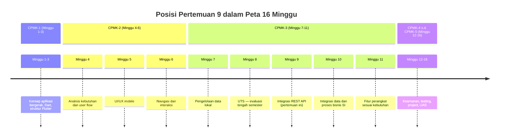
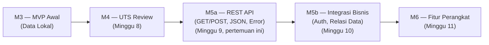
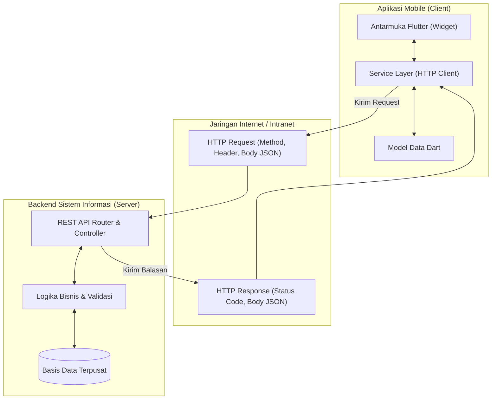
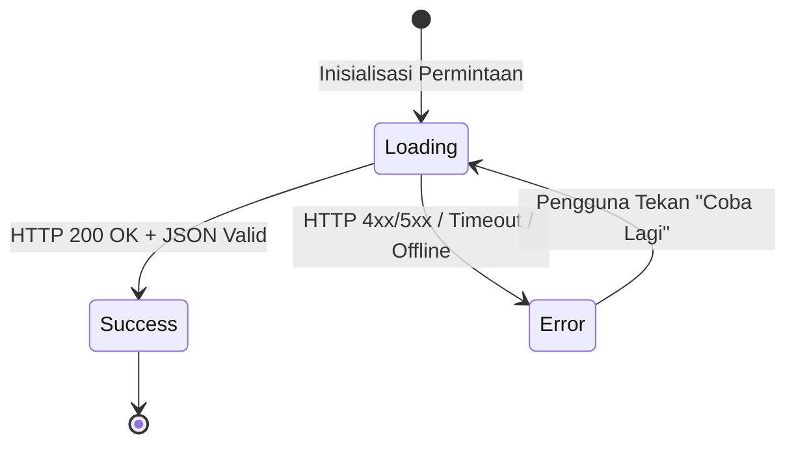

# Pertemuan 9 — Integrasi REST API

| | |
|:--|:--|
| **Minggu** | 9 |
| **Tanggal** | Rabu, 11 November 2026 (SI-VIIB) / Sabtu, 14 November 2026 (SI-VIIA) |
| **CPMK** | CPMK-3 |
| **Model Pembelajaran** | Case Based Learning / Project Based Learning |
| **Stack** | Flutter + Dart (`Future`, `async`/`await`, package `http`, `Uri`, JSON parsing, loading state, error handling) |
| **Milestone** | M5 — Integrasi REST API |

> **Catatan penting:** Pertemuan 9 membahas **integrasi REST API**: menghubungkan aplikasi mobile dengan backend Sistem Informasi — mengirim HTTP request, menerima response JSON, menguraikan response menjadi model data, serta menangani kondisi loading, berhasil, dan error. Pertemuan ini memulai **M5 — Integrasi REST API** dan menjawab keterbatasan yang dihadapi pada Pertemuan 7: data yang disimpan lokal pada perangkat hanya berlaku untuk satu pengguna dan satu perangkat, sedangkan proses bisnis Sistem Informasi memerlukan data yang dapat diakses bersama secara konsisten.
>
> **Batas cakupan:** Pertemuan ini berfokus pada operasi dasar REST API: HTTP `GET` (mengambil daftar dan detail) dan HTTP `POST` (mengirim data baru) menggunakan package `http` bawaan ekosistem Dart. Kode diverifikasi menggunakan target web (`flutter run -d chrome`) atau DartPad, **tanpa emulator**. Integrasi beberapa endpoint dan proses bisnis dibahas pada **Pertemuan 10**. Autentikasi berbasis token (`Bearer token`, login/register), validasi, dan keamanan praktis dibahas pada **Pertemuan 12**. Pagination data dalam jumlah besar, sinkronisasi offline–online, serta state management tingkat lanjut seperti `provider` atau `bloc` berada di luar cakupan pertemuan ini.

---

## Daftar Isi

- [Pertemuan 9 — Integrasi REST API](#pertemuan-9--integrasi-rest-api)
  - [Daftar Isi](#daftar-isi)
  - [1. Keterkaitan Pertemuan dengan RPS OBE](#1-keterkaitan-pertemuan-dengan-rps-obe)
  - [2. Capaian Pembelajaran Pertemuan](#2-capaian-pembelajaran-pertemuan)
  - [3. Pemantik Kasus: Data yang Terisolasi di Satu Perangkat](#3-pemantik-kasus-data-yang-terisolasi-di-satu-perangkat)
  - [4. REST dan Arsitektur Client–Server](#4-rest-dan-arsitektur-clientserver)
    - [4.1 Konsep REST API dalam Sistem Informasi](#41-konsep-rest-api-dalam-sistem-informasi)
    - [4.2 Metode HTTP](#42-metode-http)
    - [4.3 Format Pertukaran Data JSON](#43-format-pertukaran-data-json)
  - [5. Pemrograman Asynchronous di Dart](#5-pemrograman-asynchronous-di-dart)
    - [5.1 Future dan Tiga Keadaannya](#51-future-dan-tiga-keadaannya)
    - [5.2 Kata Kunci async dan await](#52-kata-kunci-async-dan-await)
    - [5.3 Mengapa Operasi Jaringan Wajib Asynchronous](#53-mengapa-operasi-jaringan-wajib-asynchronous)
  - [6. Package http dan Pembentukan Request](#6-package-http-dan-pembentukan-request)
    - [6.1 Menambahkan Dependency http](#61-menambahkan-dependency-http)
    - [6.2 Membentuk URI dengan Uri.parse](#62-membentuk-uri-dengan-uriparse)
    - [6.3 Mengirim HTTP GET Request](#63-mengirim-http-get-request)
    - [6.4 Mengirim HTTP POST Request](#64-mengirim-http-post-request)
  - [7. Parsing Response JSON ke Model Data](#7-parsing-response-json-ke-model-data)
    - [7.1 Factory Constructor fromJson](#71-factory-constructor-fromjson)
    - [7.2 Mengurai List Objek JSON](#72-mengurai-list-objek-json)
    - [7.3 Serialisasi ke JSON dengan toJson](#73-serialisasi-ke-json-dengan-tojson)
  - [8. Penanganan Tiga State Antarmuka: Loading, Sukses, dan Error](#8-penanganan-tiga-state-antarmuka-loading-sukses-dan-error)
    - [8.1 Tiga Kondisi pada Antarmuka Jaringan](#81-tiga-kondisi-pada-antarmuka-jaringan)
    - [8.2 Pola 1: FutureBuilder](#82-pola-1-futurebuilder)
    - [8.3 Pola 2: StatefulWidget dengan Flag State Mandiri](#83-pola-2-statefulwidget-dengan-flag-state-mandiri)
    - [8.4 Error Handling: try-catch, Status Code, dan Timeout](#84-error-handling-try-catch-status-code-dan-timeout)
  - [9. Pemisahan Tanggung Jawab: Lapisan Service](#9-pemisahan-tanggung-jawab-lapisan-service)
  - [10. Case Based Learning: Integrasi API Pengajuan Laboratorium](#10-case-based-learning-integrasi-api-pengajuan-laboratorium)
  - [11. Aktivitas Kelompok](#11-aktivitas-kelompok)
  - [12. Latihan Individu](#12-latihan-individu)
  - [13. Pemanfaatan AI sebagai Coding Assistant](#13-pemanfaatan-ai-sebagai-coding-assistant)
  - [14. Kuis Formatif](#14-kuis-formatif)
  - [15. Keluaran Pembelajaran — Tugas 9](#15-keluaran-pembelajaran--tugas-9)
    - [Cara Pengumpulan — Push ke Repository GitHub Kelas](#cara-pengumpulan--push-ke-repository-github-kelas)
  - [16. Rubrik Tugas 9](#16-rubrik-tugas-9)
  - [17. Verifikasi Kode — Dua Jalur](#17-verifikasi-kode--dua-jalur)
    - [Peta File ke Jalur Verifikasi](#peta-file-ke-jalur-verifikasi)
    - [Jalur 1: DartPad](#jalur-1-dartpad)
    - [Jalur 2: Flutter SDK (Target Web / Chrome)](#jalur-2-flutter-sdk-target-web--chrome)
  - [18. Persiapan ke Pertemuan 10](#18-persiapan-ke-pertemuan-10)
    - [📎 Lampiran: Kode Praktikum](#-lampiran-kode-praktikum)

---

## 1. Keterkaitan Pertemuan dengan RPS OBE

Pertemuan 9 melanjutkan capaian **CPMK-3** — mahasiswa mampu mengimplementasikan aplikasi bergerak yang mengelola data sesuai kebutuhan proses bisnis Sistem Informasi. Pada pertemuan ini, fokus pembelajaran adalah **menghubungkan aplikasi Flutter ke layanan REST API**: membentuk HTTP request, mengirim dan menerima payload JSON, mengonversi data mentah menjadi objek model Dart, serta menangani kegagalan jaringan secara anggun (*graceful*).

> Pada Pertemuan 7, data disimpan secara lokal pada memori perangkat. Jika dua mahasiswa menggunakan aplikasi di perangkat masing-masing, data peminjaman mahasiswa A tidak dapat dilihat oleh mahasiswa B maupun petugas laboratorium. Melalui integrasi REST API, aplikasi mobile terhubung ke backend server terpusat. Server bertindak sebagai otoritas tunggal penyimpanan data dan penegak aturan proses bisnis.



Keterkaitan dengan milestone: pertemuan ini menandai dimulainya **Milestone M5 — Integrasi REST API**. Deliverable tahap awal adalah aplikasi yang mampu melakukan request `GET` dan `POST`, mengurai response JSON, serta memiliki penanganan visual untuk kondisi loading dan error.



---

## 2. Capaian Pembelajaran Pertemuan

Setelah mengikuti pertemuan ini, mahasiswa mampu:

| No. | Kemampuan | Indikator |
|:---:|:----------|:----------|
| 1 | Menjelaskan konsep REST API dalam arsitektur SI | Menjelaskan peran HTTP method (`GET`, `POST`), URL endpoint, status code, dan payload JSON pada arsitektur client–server |
| 2 | Menerapkan asynchronous programming dengan Dart | Menggunakan `Future`, `async`, dan `await` untuk menangani proses I/O jaringan tanpa membekukan antarmuka pengguna |
| 3 | Mengonsumsi REST API dengan package `http` | Melakukan pemanggilan `http.get` dan `http.post` dengan penentuan URL, headers, dan body JSON yang tepat |
| 4 | Melakukan serialisasi dan deserialisasi JSON | Mengonversi string JSON menjadi Map/List, memetakan ke objek model menggunakan factory constructor `fromJson`, serta memformat objek ke JSON dengan `toJson` |
| 5 | Mengelola tiga kondisi antarmuka | Mengimplementasikan tampilan antarmuka saat loading (misal `CircularProgressIndicator`), saat data sukses dimuat, dan saat terjadi kegagalan |
| 6 | Menerapkan error handling jaringan | Menangani error jaringan, batas waktu (*timeout*), dan HTTP error status (4xx/5xx) dengan blok `try-catch` dan pesan informatif |

---

## 3. Pemantik Kasus: Data yang Terisolasi di Satu Perangkat

Perhatikan skenario operasional pada sistem peminjaman ruang laboratorium kampus berikut:

> "Mahasiswa A membuka aplikasi mobile di ponselnya dan mengisi formulir peminjaman Lab Komputer untuk hari Kamis jam 09.00. Formulir berhasil disimpan dan muncul pada daftar riwayat di ponselnya. Beberapa menit kemudian, Mahasiswa B membuka aplikasi di ponsel miliknya, melihat slot jam 09.00 kosong, lalu mengajukan peminjaman di ruang dan jam yang sama. Ketika keduanya tiba di laboratorium pada hari Kamis, terjadi bentrok jadwal karena petugas lab hanya memiliki satu ruangan."

Tabel analisis masalah:

| Gejala Masalah | Akar Penyebab Teknis | Konsekuensi Bisnis |
|:---------------|:---------------------|:-------------------|
| Mahasiswa B tidak melihat pengajuan Mahasiswa A | Data hanya disimpan di memori lokal ponsel Mahasiswa A | Terjadi duplikasi reservasi pada ruang dan waktu yang sama |
| Petugas laboratorium tidak menerima pengajuan | Tidak ada server sentral yang menghubungkan aplikasi pemohon dengan sistem pengelola | Layanan terhambat, verifikasi harus dilakukan manual |
| Jika ponsel Mahasiswa A mati, data hilang (in-memory) | Data tidak dipersistensikan ke database server | Riwayat transaksi hilang tanpa jejak audit |

Pertanyaan pemantik untuk didiskusikan:
- Mengapa aplikasi mobile Sistem Informasi wajib terhubung ke server terpusat?
- Apa peran REST API sebagai penghubung antara aplikasi mobile (Flutter) dan basis data backend?
- Apa yang harus ditampilkan aplikasi jika internet tiba-tiba terputus saat pengguna menekan tombol kirim?

---

## 4. REST dan Arsitektur Client–Server

### 4.1 Konsep REST API dalam Sistem Informasi

REST (*Representational State Transfer*) adalah standar arsitektur komunikasi berbasis protokol HTTP. Dalam Sistem Informasi modern:
1. **Client (Frontend/Mobile):** Bertanggung jawab atas antarmuka pengguna, validasi input awal, dan penyajian informasi kepada pengguna.
2. **Server (Backend API):** Bertindak sebagai pengelola logika bisnis, penegak aturan validasi otoritatif, dan pengontrol akses basis data.
3. **HTTP/JSON:** Media komunikasi standar yang bersifat *stateless* (tiap permintaan membawa seluruh informasi yang diperlukan tanpa bergantung pada sesi sebelumnya).



### 4.2 Metode HTTP

Setiap operasi pada REST API dipetakan ke metode HTTP standar:

| Metode | Deskripsi Operasi | Karakteristik | Contoh Kasus Pengajuan Lab |
|:-------|:------------------|:--------------|:---------------------------|
| `GET` | Mengambil atau membaca data dari server | Idempoten & aman (tidak mengubah state server) | `GET /api/pengajuan` (daftar)<br>`GET /api/pengajuan/12` (detail) |
| `POST` | Mengirim data baru untuk diproses dan disimpan | Non-idempoten (eksekusi berulang membuat data ganda) | `POST /api/pengajuan` (mengajukan pinjaman baru) |
| `PUT` | Mengganti keseluruhan isi data yang telah ada | Idempoten | `PUT /api/pengajuan/12` (memperbarui seluruh field) |
| `PATCH` | Memperbarui sebagian field pada data yang ada | Non-idempoten / bervariasi | `PATCH /api/pengajuan/12` (hanya mengubah status) |
| `DELETE` | Menghapus sumber daya data tertentu | Idempoten | `DELETE /api/pengajuan/12` (membatalkan pengajuan) |

### 4.3 Format Pertukaran Data JSON

JSON (*JavaScript Object Notation*) adalah format teks terstruktur yang digunakan sebagai payload komunikasi.

Contoh payload response `GET /api/pengajuan/1`:
```json
{
  "id": 1,
  "ruang": "Laboratorium Multimedia",
  "tanggal": "2026-11-15",
  "jam": "08:00 - 10:00",
  "status": "menunggu"
}
```

Contoh payload list `GET /api/pengajuan`:
```json
[
  {
    "id": 1,
    "ruang": "Laboratorium Multimedia",
    "tanggal": "2026-11-15",
    "jam": "08:00 - 10:00",
    "status": "menunggu"
  },
  {
    "id": 2,
    "ruang": "Laboratorium Jaringan",
    "tanggal": "2026-11-16",
    "jam": "13:00 - 15:00",
    "status": "disetujui"
  }
]
```

---

## 5. Pemrograman Asynchronous di Dart

### 5.1 Future dan Tiga Keadaannya

Komunikasi jaringan membutuhkan waktu transmisi yang bergantung pada kualitas sinyal, kecepatan server, dan jarak geografis. Operasi ini tidak dapat diselesaikan secara instan dalam 1 siklus CPU.

Untuk menangani proses tunda ini, Dart menyediakan tipe `Future<T>`. Sebuah `Future` berada dalam salah satu dari 3 keadaan:
1. **Uncompleted (Pending):** Operasi sedang berjalan; nilai belum siap.
2. **Completed with Value (Success):** Operasi selesai dan mengembalikan data bertipe `T`.
3. **Completed with Error (Failed):** Terjadi kegagalan (misalnya koneksi putus, server down) dan menghasilkan objek `Exception` atau `Error`.

### 5.2 Kata Kunci async dan await

Sintaks `async` dan `await` memungkinkan penulisan kode asynchronous dengan gaya yang rapi dan mudah dibaca secara sekuensial.

```dart
// Fungsi yang mengembalikan Future ditandai kata kunci async
Future<String> ambilDataServer() async {
  // await menghentikan eksekusi baris berikutnya sampai Future selesai
  final response = await http.get(Uri.parse('https://api.example.com/data'));
  return response.body;
}
```

### 5.3 Mengapa Operasi Jaringan Wajib Asynchronous

Aplikasi Flutter berjalan pada satu utas utama yang disebut **UI Thread (Main Isolate)**. Utas ini bertanggung jawab menggambar antarmuka pada perangkat sebanyak 60 hingga 120 kali per detik (frame rendering).

| Pendekatan | Mekanisme Eksekusi | Dampak pada Pengguna |
|:-----------|:-------------------|:---------------------|
| **Synchronous / Blocking** | UI Thread dipaksa menunggu respon jaringan selesai (misal 2 detik) | Antarmuka tidak merespons, tombol tidak menerima sentuhan, animasi macet, dan sistem operasi dapat menganggap aplikasi mengalami error |
| **Asynchronous / Non-blocking** | Request dikirim ke I/O thread latar belakang; UI Thread bebas menggambar widget | Pengguna tetap dapat berinteraksi, melihat animasi loading, atau membatalkan proses |

---

## 6. Package http dan Pembentukan Request

### 6.1 Menambahkan Dependency http

Package `http` adalah pustaka resmi untuk melakukan permintaan HTTP. Tambahkan pada file `pubspec.yaml`:

```yaml
dependencies:
  flutter:
    sdk: flutter
  http: ^1.2.0
```

Jalankan perintah berikut pada terminal:
```bash
flutter pub get
```

Pada kode Dart, impor package dengan alias konvensional `http`:
```dart
import 'package:http/http.dart' as http;
```

### 6.2 Membentuk URI dengan Uri.parse

Fungsi pada package `http` menerima parameter objek `Uri`, bukan string mentah. Gunakan `Uri.parse`:

```dart
// Endpoint standar
final uri = Uri.parse('https://jsonplaceholder.typicode.com/posts');

// Endpoint dengan query parameter
final uriFilter = Uri.https(
  'jsonplaceholder.typicode.com',
  '/posts',
  {'userId': '1'},
);
```

### 6.3 Mengirim HTTP GET Request

Untuk mengambil data dari server, gunakan `http.get`:

```dart
Future<void> bacaData() async {
  final url = Uri.parse('https://jsonplaceholder.typicode.com/posts/1');
  
  final response = await http.get(url);
  
  if (response.statusCode == 200) {
    print('Response body: ${response.body}');
  } else {
    print('Gagal memuat data. Status code: ${response.statusCode}');
  }
}
```

Status code HTTP yang umum ditemui:
- `200 OK`: Permintaan berhasil dan data disertakan dalam response body.
- `201 Created`: Data baru berhasil dibuat (biasanya balasan dari `POST`).
- `400 Bad Request`: Format request salah atau parameter tidak lengkap.
- `404 Not Found`: Endpoint atau ID sumber daya tidak ditemukan.
- `500 Internal Server Error`: Terjadi kegagalan di sisi kode backend server.

### 6.4 Mengirim HTTP POST Request

Untuk membuat data baru, kirim data dalam format JSON melalui body request beserta header `Content-Type`:

```dart
import 'dart:convert';

Future<void> kirimData() async {
  final url = Uri.parse('https://jsonplaceholder.typicode.com/posts');
  
  final payload = {
    'title': 'Peminjaman Ruang Lab',
    'body': 'Permohonan pinjam Lab Komputer 1',
    'userId': 1,
  };

  final response = await http.post(
    url,
    headers: {
      'Content-Type': 'application/json; charset=UTF-8',
    },
    body: jsonEncode(payload),
  );

  if (response.statusCode == 201) {
    print('Data berhasil dibuat: ${response.body}');
  } else {
    print('Gagal membuat data. Status code: ${response.statusCode}');
  }
}
```

> **Perhatian khusus:** Selalu sertakan header `'Content-Type': 'application/json'` saat mengirim payload JSON melalui metode `POST`/`PUT`. Tanpa header ini, backend dapat salah mengartikan body sebagai teks mentah atau URL-encoded form.

---

## 7. Parsing Response JSON ke Model Data

### 7.1 Factory Constructor fromJson

String JSON yang diterima dari `response.body` perlu diubah menjadi objek model Dart yang memiliki tipe data kuat (*type-safe*). Langkah ini mencegah salah ketik nama key dan memudahkan akses properti dengan fitur auto-complete pada IDE.

Model data dengan pola deserialisasi:
```dart
class DataPengajuan {
  const DataPengajuan({
    required this.id,
    required this.ruang,
    required this.tanggal,
    required this.jam,
    required this.status,
  });

  final int id;
  final String ruang;
  final String tanggal;
  final String jam;
  final String status;

  /// Mengonversi Map (hasil jsonDecode) menjadi objek DataPengajuan
  factory DataPengajuan.fromJson(Map<String, dynamic> json) {
    return DataPengajuan(
      id: json['id'] as int? ?? 0,
      ruang: json['ruang'] as String? ?? 'Tanpa Nama Ruang',
      tanggal: json['tanggal'] as String? ?? '-',
      jam: json['jam'] as String? ?? '-',
      status: json['status'] as String? ?? 'menunggu',
    );
  }
}
```

### 7.2 Mengurai List Objek JSON

Jika endpoint mengembalikan array JSON (banyak data), gunakan kombinasi `jsonDecode` dan metode `map`:

```dart
import 'dart:convert';

List<DataPengajuan> parseDaftarPengajuan(String responseBody) {
  // 1. Ubah string JSON mentah menjadi List dynamic
  final List<dynamic> dataMentah = jsonDecode(responseBody) as List<dynamic>;

  // 2. Petakan setiap elemen Map ke objek DataPengajuan
  return dataMentah
      .map((item) => DataPengajuan.fromJson(item as Map<String, dynamic>))
      .toList();
}
```

### 7.3 Serialisasi ke JSON dengan toJson

Ketika mengirim data objek Dart ke backend, sediakan method `toJson` yang menghasilkan `Map<String, dynamic>`:

```dart
class DataPengajuanBaru {
  const DataPengajuanBaru({
    required this.ruang,
    required this.tanggal,
    required this.jam,
  });

  final String ruang;
  final String tanggal;
  final String jam;

  Map<String, dynamic> toJson() {
    return {
      'ruang': ruang,
      'tanggal': tanggal,
      'jam': jam,
      'status': 'menunggu',
    };
  }
}

// Penggunaan saat kirim:
// body: jsonEncode(pengajuanBaru.toJson())
```

---

## 8. Penanganan Tiga State Antarmuka: Loading, Sukses, dan Error

### 8.1 Tiga Kondisi pada Antarmuka Jaringan

Karena proses jaringan berlangsung asinkron, antarmuka pengguna harus mampu mencerminkan tiga kondisi siklus hidup data:
1. **Loading State:** Data sedang diambil; tampilkan indikator visual (misal `CircularProgressIndicator`) agar pengguna tahu sistem sedang bekerja.
2. **Success State:** Data berhasil diterima; bangun daftar item menggunakan widget visual seperti `ListView.builder`.
3. **Error State:** Koneksi gagal atau server bermasalah; tampilkan pesan error yang informatif serta tombol untuk mencoba kembali (*retry*).



### 8.2 Pola 1: FutureBuilder

`FutureBuilder` adalah widget bawaan Flutter yang secara otomatis mengamati perubahan status sebuah `Future` dan membangun antarmuka sesuai keadaan koneksinya (`ConnectionState`).

```dart
class HalamanDaftarFutureBuilder extends StatelessWidget {
  const HalamanDaftarFutureBuilder({super.key});

  @override
  Widget build(BuildContext context) {
    return Scaffold(
      appBar: AppBar(title: const Text('Daftar Pengajuan (FutureBuilder)')),
      body: FutureBuilder<List<DataPengajuan>>(
        // future dipanggil di sini atau disimpan di initState
        future: LaboratoriumService.ambilSemuaPengajuan(),
        builder: (context, snapshot) {
          // 1. Kondisi Loading
          if (snapshot.connectionState == ConnectionState.waiting) {
            return const Center(child: CircularProgressIndicator());
          }

          // 2. Kondisi Error
          if (snapshot.hasError) {
            return Center(
              child: Padding(
                padding: const EdgeInsets.all(16),
                child: Text(
                  'Terjadi kendala: ${snapshot.error}',
                  textAlign: TextAlign.center,
                  style: const TextStyle(color: Colors.red),
                ),
              ),
            );
          }

          // 3. Kondisi Data Kosong
          final daftar = snapshot.data ?? [];
          if (daftar.isEmpty) {
            return const Center(child: Text('Belum ada data pengajuan.'));
          }

          // 4. Kondisi Sukses
          return ListView.builder(
            itemCount: daftar.length,
            itemBuilder: (context, index) {
              final item = daftar[index];
              return ListTile(
                title: Text(item.ruang),
                subtitle: Text('${item.tanggal} (${item.jam})'),
                trailing: Text(item.status),
              );
            },
          );
        },
      ),
    );
  }
}
```

> **Perhatian Arsitektur:** Jika `future:` pada `FutureBuilder` diisi langsung dengan pemanggilan fungsi (misal `future: fetch()`), fungsi tersebut akan terpanggil ulang setiap kali widget dirender ulang. Untuk mencegah pemanggilan ganda, simpan variabel `Future` di dalam `initState` pada `StatefulWidget`.

### 8.3 Pola 2: StatefulWidget dengan Flag State Mandiri

Pendekatan ini memberikan kendali manual yang lebih fleksibel, terutama jika halaman memerlukan operasi penambahan data atau penyegaran (*pull to refresh*).

```dart
class HalamanDaftarManual extends StatefulWidget {
  const HalamanDaftarManual({super.key});

  @override
  State<HalamanDaftarManual> createState() => _HalamanDaftarManualState();
}

class _HalamanDaftarManualState extends State<HalamanDaftarManual> {
  bool _sedangMemuat = false;
  String? _pesanError;
  List<DataPengajuan> _daftar = [];

  @override
  void initState() {
    super.initState();
    _muatData();
  }

  Future<void> _muatData() async {
    setState(() {
      _sedangMemuat = true;
      _pesanError = null;
    });

    try {
      final hasil = await LaboratoriumService.ambilSemuaPengajuan();
      setState(() {
        _daftar = hasil;
        _sedangMemuat = false;
      });
    } catch (e) {
      setState(() {
        _pesanError = e.toString();
        _sedangMemuat = false;
      });
    }
  }

  @override
  Widget build(BuildContext context) {
    return Scaffold(
      appBar: AppBar(title: const Text('Daftar Pengajuan')),
      body: _bangunKonten(),
    );
  }

  Widget _bangunKonten() {
    if (_sedangMemuat) {
      return const Center(child: CircularProgressIndicator());
    }

    if (_pesanError != null) {
      return Center(
        child: Column(
          mainAxisAlignment: MainAxisAlignment.center,
          children: [
            Text('Gagal: $_pesanError', textAlign: TextAlign.center),
            const SizedBox(height: 12),
            FilledButton(
              onPressed: _muatData,
              child: const Text('Coba Lagi'),
            ),
          ],
        ),
      );
    }

    if (_daftar.isEmpty) {
      return const Center(child: Text('Data kosong.'));
    }

    return RefreshIndicator(
      onRefresh: _muatData,
      child: ListView.builder(
        itemCount: _daftar.length,
        itemBuilder: (context, index) {
          final item = _daftar[index];
          return ListTile(
            title: Text(item.ruang),
            subtitle: Text(item.tanggal),
          );
        },
      ),
    );
  }
}
```

### 8.4 Error Handling: try-catch, Status Code, dan Timeout

Penanganan error yang baik melindungi aplikasi dari kegagalan mendadak (*unhandled exception*):

```dart
import 'dart:async';
import 'dart:io';

Future<List<DataPengajuan>> ambilDataAman() async {
  final url = Uri.parse('https://api.example.com/pengajuan');

  try {
    final response = await http
        .get(url)
        .timeout(const Duration(seconds: 10)); // Batas waktu tunggu

    if (response.statusCode == 200) {
      return parseDaftarPengajuan(response.body);
    } else if (response.statusCode == 404) {
      throw Exception('Data pengajuan tidak ditemukan di server (404).');
    } else {
      throw Exception('Server mengembalikan kode error: ${response.statusCode}');
    }
  } on TimeoutException {
    throw Exception('Koneksi terputus: waktu tunggu habis (timeout). Periksa jaringan Anda.');
  } on SocketException {
    throw Exception('Tidak ada koneksi internet. Pastikan perangkat terhubung jaringan.');
  } catch (e) {
    throw Exception('Terjadi kegagalan komunikasi: $e');
  }
}
```

---

## 9. Pemisahan Tanggung Jawab: Lapisan Service

Jangan mencampur kode HTTP request langsung di dalam widget tampilan. Pisahkan logika jaringan ke dalam class tersendiri yang disebut **Service**.

Keuntungan arsitektur berorientasi Service:
- **Keterbacaan:** Widget tampilan hanya fokus pada tata letak dan interaksi UI.
- **Dapat Digunakan Ulang (Reusable):** Fungsi ambil data dapat dipanggil dari berbagai halaman tanpa menulis ulang URL dan parsing JSON.
- **Mudah Diuji:** Logika komunikasi data terisolasi dari siklus hidup widget.

```dart
/// Lapisan Service — mengisolasi seluruh interaksi HTTP
class LaboratoriumService {
  static const String _baseUrl = 'https://jsonplaceholder.typicode.com';

  /// Mengambil daftar pengajuan dari API
  static Future<List<DataPengajuan>> ambilDaftar() async {
    final url = Uri.parse('$_baseUrl/posts');
    final response = await http.get(url).timeout(const Duration(seconds: 10));

    if (response.statusCode == 200) {
      final List<dynamic> jsonList = jsonDecode(response.body) as List<dynamic>;
      return jsonList
          .take(10) // batasi contoh 10 data
          .map((item) => DataPengajuan.fromJson(item as Map<String, dynamic>))
          .toList();
    } else {
      throw Exception('Gagal memuat data (HTTP ${response.statusCode})');
    }
  }

  /// Mengirim pengajuan baru ke API
  static Future<DataPengajuan> kirimPengajuan(DataPengajuanBaru dataBaru) async {
    final url = Uri.parse('$_baseUrl/posts');
    final response = await http.post(
      url,
      headers: {'Content-Type': 'application/json; charset=UTF-8'},
      body: jsonEncode(dataBaru.toJson()),
    ).timeout(const Duration(seconds: 10));

    if (response.statusCode == 201) {
      final Map<String, dynamic> jsonItem = jsonDecode(response.body) as Map<String, dynamic>;
      return DataPengajuan.fromJson(jsonItem);
    } else {
      throw Exception('Gagal membuat pengajuan baru (HTTP ${response.statusCode})');
    }
  }
}
```

---

## 10. Case Based Learning: Integrasi API Pengajuan Laboratorium

**Konteks Kasus:**
Melanjutkan kasus pada Pertemuan 4–7, proses bisnis peminjaman laboratorium kampus kini dilengkapi dengan backend API terpusat. Mahasiswa tidak lagi menyimpan pengajuan di memori lokal ponsel. Sebagai gantinya:
1. Ketika halaman riwayat dibuka, aplikasi mengirimkan `GET /posts` untuk mengambil daftar peminjaman terkini.
2. Ketika mahasiswa mengisi form pengajuan dan menekan tombol "Kirim", aplikasi mengirimkan `POST /posts` dengan payload JSON.
3. Selama proses kirim berlangsung, tombol menampilkan status pemrosesan dan mencegah penekanan ganda.
4. Jika server merespon sukses (`201 Created`), aplikasi menampilkan pemberitahuan berhasil dan memperbarui daftar data.

**Pertanyaan Diskusi Kasus:**
1. Apa risiko jika tombol "Kirim" tidak dinonaktifkan saat request HTTP sedang berjalan?
2. Mengapa format tanggal dan jam harus disepakati antara frontend dan backend sebelum kode ditulis?
3. Jika jaringan internet tiba-tiba mati saat data dikirim, pesan seperti apa yang tepat disajikan kepada mahasiswa pemohon?

Kode penyelesaian kasus CBL ini dapat dipelajari secara lengkap pada berkas [`code/pertemuan-09/demo-rest-api-flutter.dart`](../code/pertemuan-09/demo-rest-api-flutter.dart).

---

## 11. Aktivitas Kelompok

Bentuk kelompok kerja yang terdiri atas 3–4 mahasiswa:

1. **Analisis Kontrak API (15 menit):**
   - Buka dokumen kebutuhan project Anda (Tugas 4).
   - Tentukan minimal dua endpoint yang dibutuhkan aplikasi mobile Anda (1 endpoint `GET` untuk membaca data, 1 endpoint `POST` untuk membuat data).
   - Susun struktur kontrak payload JSON (field, tipe data, dan contoh nilainya).
2. **Uji Endpoint Daring (15 menit):**
   - Gunakan endpoint simulasi terbuka seperti `https://jsonplaceholder.typicode.com/posts` atau endpoint backend kelompok Anda.
   - Uji pemanggilan menggunakan perkakas peramban atau API client.
3. **Presentasi Rancangan (5 menit/kelompok):**
   - Jelaskan model data Dart yang akan dibentuk dari response JSON tersebut.
   - Tunjukkan bagaimana penanganan error ditampilkan saat endpoint dipanggil tanpa koneksi internet.

---

## 12. Latihan Individu

Kerjakan latihan terbimbing pada berkas [`code/pertemuan-09/latihan-rest-api-flutter.dart`](../code/pertemuan-09/latihan-rest-api-flutter.dart). Kasus latihan: **Menampilkan dan Mencari Katalog Buku Perpustakaan melalui REST API**.

Tahapan pengerjaan (6 TODO):
- **TODO 1:** Lengkapi definisi model `DataBuku` dan factory constructor `fromJson`.
- **TODO 2:** Buat method `ambilKatalog()` pada class service dengan pemanggilan `http.get`.
- **TODO 3:** Terapkan deserialisasi JSON list menjadi `List<DataBuku>`.
- **TODO 4:** Kelola state loading, data sukses, dan error pada `StatefulWidget`.
- **TODO 5:** Tampilkan data katalog menggunakan `ListView.builder` dan `Card`.
- **TODO 6:** Tambahkan tombol "Coba Lagi" saat snapshot error terjadi.

---

## 13. Pemanfaatan AI sebagai Coding Assistant

**AI assistant (GitHub Copilot, ChatGPT, Claude, Gemini, Cursor) dapat digunakan sebagai alat bantu pembelajaran dengan ketentuan berikut:**

**✅ Gunakan AI untuk:**

- Menjelaskan pesan error HTTP, `FutureBuilder`, `jsonDecode`, dan factory constructor `fromJson`.
- Membantu membaca contoh JSON dan menyusun pertanyaan pemeriksaan field model.
- Mereview pemisahan logika HTTP, parsing JSON, dan tampilan pada service layer.
- Mengusulkan skenario pengujian loading, sukses, timeout, dan error setelah kontrak API dipahami.

**❌ Jangan gunakan AI untuk:**

- Menghasilkan seluruh Tugas 9 tanpa memahami alur request, response, parsing JSON, dan state antarmuka.
- Menyalin kode tanpa dapat menjelaskan peran `http.get`, `http.post`, `jsonDecode`, dan `setState`.
- Memasukkan token, kredensial, atau data pengguna nyata ke dalam prompt.
- Menganggap response API benar tanpa memeriksa status code dan struktur JSON.

**Etika di kelas ini:**

1. Anda **wajib dapat menjelaskan** endpoint, model, parsing JSON, status loading/sukses/error, dan service layer yang dikumpulkan.
2. Jika memakai AI, **cantumkan** pada bagian akhir laporan tugas:

  ```text
  Deklarasi penggunaan AI: GitHub Copilot — membantu menjelaskan pemetaan
  field JSON ke factory constructor; kode, penanganan error, dan pengujian
  diverifikasi oleh penulis.
  ```

3. AI digunakan sebagai **asisten pembelajaran**, bukan sebagai **pengganti proses implementasi dan pengujian**. Anda tetap bertanggung jawab atas kode yang dikumpulkan.

---

## 14. Kuis Formatif

Kerjakan kuis pemahaman konsep berikut (10 menit, tanpa membuka catatan):

1. Mengapa operasi jaringan pada aplikasi Flutter wajib bersifat *asynchronous* (`Future`)? Apa akibat teknis jika operasi jaringan dijalankan secara *blocking*?
2. Jelaskan perbedaan mendasar fungsi metode HTTP `GET` dan `POST` dalam pengelolaan data aplikasi bergerak!
3. Apa fungsi fungsi `jsonDecode()` dari pustaka `dart:convert`, dan mengapa kita memerlukan factory constructor `fromJson` pada class model?
4. Sebutkan tiga kondisi tampilan (*state*) yang wajib ditangani antarmuka pengguna saat melakukan pemanggilan REST API!
5. Mengapa penanganan batas waktu (*timeout*) dan blok `try-catch` penting diterapkan pada pemanggilan fungsi `http.get`?
6. Apa keuntungan memisahkan kode pemanggilan HTTP ke dalam lapisan *Service* dibanding menulisnya langsung di dalam method `build` widget?

---

## 15. Keluaran Pembelajaran — Tugas 9

**Tugas 9 — Implementasi Konsumsi REST API pada Flutter** (Praktikum individu). Panduan pengerjaan tersedia di [`contoh-tugas-9-mahasiswa.md`](./contoh-tugas-9-mahasiswa.md).

Gunakan domain Sistem Informasi project Anda (sesuai Tugas 4–7). Kerjakan:

1. **Pembuatan File `service-api.dart`:**
   - Model data dengan field yang relevan dan factory constructor `fromJson`.
   - Class service terpisah yang memiliki minimal satu method `GET` (mengambil daftar data) dan satu method `POST` (mengirim data baru).
   - Penggunaan `try-catch`, penanganan status code HTTP, dan batas waktu *timeout*.
2. **Pembuatan Antarmuka `halaman-api.dart`:**
   - Halaman daftar yang mengonsumsi method `GET` dari service.
   - Penanganan visual yang jelas untuk 3 kondisi: indikator loading, tampilan data saat sukses, dan pesan error saat gagal beserta tombol *retry*.
   - Fitur kirim data melalui form sederhana yang memanggil method `POST`.
3. **Bukti Eksekusi:**
   - `screenshot-loading.png` — saat indikator loading aktif.
   - `screenshot-sukses.png` — saat data berhasil dimuat dan tampil pada antarmuka.
   - `screenshot-error.png` — saat simulasi koneksi gagal (misal URL salah/offline) menampilkan pesan error.
4. **Catatan Teknis `catatan-integrasi-api.md`:**
   - Tabel endpoint API yang digunakan (URL, HTTP Method, format payload request/response).
   - Penjelasan struktur data model dan penanganan error yang dipilih.
5. **Deklarasi AI & Refleksi 3 Kalimat** pada file `README.md`.

### Cara Pengumpulan — Push ke Repository GitHub Kelas

Tugas dikumpulkan melalui repository GitHub kelas masing-masing:

| Kelas | Repository |
|:------|:-----------|
| SI-VIIB | [SI-VIIB-Mobile](https://github.com/PBWFEND/SI-VIIB-Mobile) |
| SI-VIIA | [SI-VIIA-Mobile](https://github.com/PBWFEND/SI-VIIA-Mobile) |

Langkah pengumpulan:

Struktur minimal folder pengumpulan:

```text
tugas-9/
├── service-api.dart
├── halaman-api.dart
├── screenshot-loading.png
├── screenshot-sukses.png
├── screenshot-error.png
├── catatan-integrasi-api.md
└── README.md
```

1. Masuk ke repository lokal, pastikan berada pada branch `<nim>`, dan buat direktori tugas:
  **SI-VIIB:**
  ```bash
  git clone https://github.com/PBWFEND/SI-VIIB-Mobile.git
  cd SI-VIIB-Mobile
  git checkout <nim>
  mkdir -p tugas-9
  ```
  **SI-VIIA:**
  ```bash
  git clone https://github.com/PBWFEND/SI-VIIA-Mobile.git
  cd SI-VIIA-Mobile
  git checkout <nim>
  mkdir -p tugas-9
  ```
2. Simpan seluruh berkas tugas ke dalam folder tersebut sesuai struktur minimal.
3. Periksa kembali endpoint, screenshot, catatan teknis, refleksi, dan deklarasi AI.
4. Lakukan commit dan push:
   ```bash
  git add tugas-9
   git commit -m "tugas-9: integrasi rest api - <nama> <nim>"
  git push origin <nim>
   ```
5. Buat Pull Request dari branch tugas ke `main`:
```bash
gh pr create --base main --head <nim> --title "Tugas 9: Integrasi REST API - <nama> <nim>" --body "Pengumpulan Tugas 9 dan refleksi."
```
Jika GitHub CLI tidak tersedia, gunakan tombol **Compare & pull request** pada repository GitHub dengan `base: main` dan `compare: <nim>`.
6. Buka Pull Request di browser dan pastikan folder tugas serta seluruh berkas dapat dibaca sebelum tenggat.

---

## 16. Rubrik Tugas 9

| Kriteria | Bobot | 4 (Sangat Baik) | 3 (Baik) | 2 (Cukup) | 1 (Perlu Bimbingan) |
|:---------|:-----:|:----------------|:---------|:----------|:--------------------|
| **Model & Parsing JSON** | 25% | Model data memiliki tipe data kuat, factory `fromJson` lengkap, penanganan null aman | Model ada, `fromJson` bekerja tanpa penanganan null | Parsing bekerja namun rentan error tipe data | Tidak ada model data/parsing JSON |
| **Konsumsi HTTP (GET & POST)** | 25% | Menggunakan package `http`, pemanggilan `GET` dan `POST` berjalan dengan URL, header, dan body yang tepat | Pemanggilan `GET` dan `POST` berjalan dengan kekurangan minor pada header | Hanya mengimplementasikan `GET` saja | Operasi HTTP gagal atau tidak diimplementasikan |
| **Penanganan Tiga State UI** | 20% | Kondisi loading, sukses, dan error divisualisasikan dengan jelas; tersedia tombol retry | Tiga kondisi ditangani, tombol retry belum tersedia | Hanya menangani kondisi loading dan sukses | Tidak ada indikator loading dan error |
| **Arsitektur & Error Handling** | 15% | Logika API terpisah rapi di lapisan Service; `try-catch`, timeout, dan status code ditangani tepat | Lapisan service terpisah, namun penanganan error belum lengkap | Kode API menyatu di dalam widget UI | Tidak ada penanganan error jaringan |
| **Kelengkapan Dokumen & Refleksi** | 15% | Berkas lengkap (3 screenshot, catatan API, refleksi 3 kalimat logis, tepat waktu) | Berkas lengkap, refleksi kurang mendalam | Screenshot atau catatan teknis kurang lengkap | Pengumpulan tidak lengkap / terlambat |

**Penentuan Nilai:**
$$\text{Nilai} = \frac{\sum (\text{Bobot} \times \text{Skor})}{16} \times 100$$

---

## 17. Verifikasi Kode — Dua Jalur

### Peta File ke Jalur Verifikasi

| Berkas Kode | Jalur 1 (DartPad) | Jalur 2 (Flutter SDK / Web Chrome) | Keterangan |
|:------------|:-----------------:|:----------------------------------:|:-----------|
| `demo-rest-api-flutter.dart` | ✅ Dapat dijalankan | ✅ Dapat dijalankan | Menggunakan package `http` yang didukung DartPad |
| `latihan-rest-api-flutter.dart` | ✅ Dapat dijalankan | ✅ Dapat dijalankan | Latihan TODO terbimbing |
| Kode Tugas 9 Anda | ✅ Dapat dijalankan | ✅ Dapat dijalankan | Target web (`-d chrome`) atau DartPad |

### Jalur 1: DartPad

1. Buka peramban dan akses [DartPad](https://dartpad.dev/?template=app).
2. Salin seluruh isi file kode praktikum ke panel editor kiri DartPad.
3. Tekan tombol **Run**. Amati indikator loading berputar, data dimuat dari internet, dan daftar item muncul pada panel pratinjau.

### Jalur 2: Flutter SDK (Target Web / Chrome)

1. Buka terminal pada folder project Flutter Anda.
2. Pastikan package `http` terdaftar pada `pubspec.yaml` dan jalankan `flutter pub get`.
3. Ganti isi `lib/main.dart` dengan kode demo/tugas.
4. Jalankan aplikasi pada peramban Chrome:
   ```bash
   flutter run -d chrome
   ```
5. Periksa console log untuk memastikan tidak terdapat pesan error CORS atau format JSON.

Daftar pemeriksaan mandiri sebelum submit:

| No. | Item Pemeriksaan | Kondisi yang Diharapkan |
|:---:|:-----------------|:------------------------|
| 1 | Indikator Loading | Muncul saat proses HTTP sedang berlangsung |
| 2 | Tampilan Sukses | Data dari API terurai rapi dalam daftar widget |
| 3 | Simulasi Error | Jika URL sengaja disalahkan, aplikasi menampilkan pesan error ramah pengguna |
| 4 | Tombol Aksi | Tombol "Kirim" atau "Muat Ulang" berfungsi tanpa kendala |
| 5 | Analisis Kode | Menjalankan `flutter analyze` tidak menghasilkan error atau warning |

---

## 18. Persiapan ke Pertemuan 10

Pada pertemuan ini, mahasiswa telah menguasai dasar **integrasi REST API**: metode HTTP `GET`/`POST`, pemrograman asynchronous `async`/`await`, parsing JSON dengan `fromJson`, serta pengelolaan tiga kondisi antarmuka pengguna.

Pada **Pertemuan 10 (Integrasi Data dan Proses Bisnis SI)**, kemampuan ini akan diperluas ke:
- Penggabungan data dari beberapa endpoint.
- Pemetaan identifier antar-model dan penerapan status proses.
- Pemisahan logika integrasi pada service layer.

---

### 📎 Lampiran: Kode Praktikum

| Berkas | Deskripsi | Jalur Verifikasi |
|:-------|:----------|:-----------------|
| [`demo-rest-api-flutter.dart`](../code/pertemuan-09/demo-rest-api-flutter.dart) | Implementasi lengkap CBL: Service HTTP, model data `DataPengajuan`, loading state, penanganan error, dan form `POST` | DartPad / Flutter SDK (Chrome) |
| [`latihan-rest-api-flutter.dart`](../code/pertemuan-09/latihan-rest-api-flutter.dart) | Kerangka latihan praktikum mandiri dengan 6 TODO terstruktur | DartPad / Flutter SDK (Chrome) |
| [`contoh-tugas-9-mahasiswa.md`](./contoh-tugas-9-mahasiswa.md) | Panduan teknis dan daftar periksa penyusunan berkas Tugas 9 | — |
| [`../MILESTONE.md`](../MILESTONE.md) | Acuan deliverable Milestone M5 tahap awal | — |
