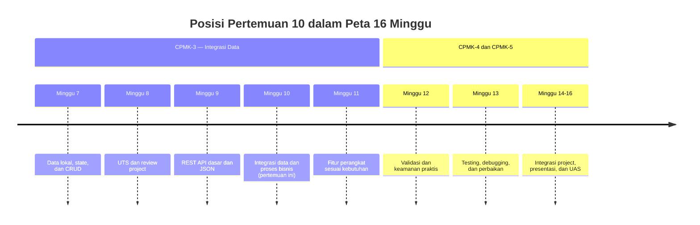
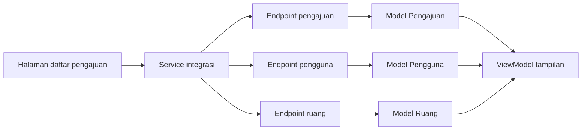
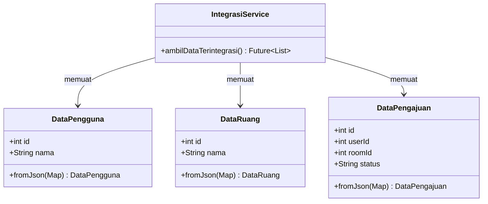

# Pertemuan 10 — Integrasi Data dan Proses Bisnis Sistem Informasi

| | |
|:--|:--|
| **Minggu** | 10 |
| **Tanggal** | Rabu, 18 November 2026 (SI-VIIB) / Sabtu, 21 November 2026 (SI-VIIA) |
| **CPMK** | CPMK-3 |
| **Model Pembelajaran** | Case Based Learning / Project Based Learning |
| **Stack** | Flutter + Dart (`http`, `Future`, `async`/`await`, JSON parsing, `Future.wait`) |
| **Milestone** | M5b — Integrasi Data dan Proses Bisnis |

> **Catatan penting:** Pertemuan 10 melanjutkan integrasi REST API pada Pertemuan 9. Fokus pembelajaran adalah menggabungkan data dari beberapa endpoint, memetakan data ke model Dart, menerapkan aturan proses bisnis pada service layer, dan menampilkan status proses pada halaman aplikasi.
>
> **Batas cakupan:** Pertemuan ini menggunakan API simulasi publik untuk mempraktikkan integrasi data dan alur proses. Token authentication, secure storage, permission, dan perlindungan data sensitif dibahas pada Pertemuan 12. State management eksternal seperti `provider` atau `bloc` berada di luar cakupan.

---

## Daftar Isi

- [Pertemuan 10 — Integrasi Data dan Proses Bisnis Sistem Informasi](#pertemuan-10--integrasi-data-dan-proses-bisnis-sistem-informasi)
  - [Daftar Isi](#daftar-isi)
  - [1. Keterkaitan Pertemuan dengan RPS OBE](#1-keterkaitan-pertemuan-dengan-rps-obe)
  - [2. Capaian Pembelajaran Pertemuan](#2-capaian-pembelajaran-pertemuan)
  - [3. Pemantik Kasus: Data Terpisah dan Status Proses](#3-pemantik-kasus-data-terpisah-dan-status-proses)
  - [4. Integrasi Data dalam Sistem Informasi](#4-integrasi-data-dalam-sistem-informasi)
  - [5. Model Data untuk Beberapa Endpoint](#5-model-data-untuk-beberapa-endpoint)
  - [6. Service Layer dan Tanggung Jawabnya](#6-service-layer-dan-tanggung-jawabnya)
  - [7. Menggabungkan Request dengan `Future.wait`](#7-menggabungkan-request-dengan-futurewait)
  - [8. Menerapkan Aturan Proses Bisnis](#8-menerapkan-aturan-proses-bisnis)
  - [9. State Status Proses pada Halaman Flutter](#9-state-status-proses-pada-halaman-flutter)
  - [10. Penanganan Error pada Integrasi Data](#10-penanganan-error-pada-integrasi-data)
  - [11. Studi Kasus: Daftar Pengajuan Laboratorium](#11-studi-kasus-daftar-pengajuan-laboratorium)
  - [12. Latihan Terbimbing: Integrasi Data dan Proses](#12-latihan-terbimbing-integrasi-data-dan-proses)
  - [13. Aktivitas Kelompok](#13-aktivitas-kelompok)
  - [14. Latihan Individu](#14-latihan-individu)
  - [15. Pemanfaatan AI sebagai Coding Assistant](#15-pemanfaatan-ai-sebagai-coding-assistant)
  - [16. Kuis Formatif](#16-kuis-formatif)
  - [17. Keluaran Pembelajaran — Tugas 10](#17-keluaran-pembelajaran--tugas-10)
    - [Cara Pengumpulan — Push ke Repository GitHub Kelas](#cara-pengumpulan--push-ke-repository-github-kelas)
  - [18. Rubrik Penilaian](#18-rubrik-penilaian)
  - [19. Verifikasi Kode](#19-verifikasi-kode)
    - [Jalur 1 — DartPad](#jalur-1--dartpad)
    - [Jalur 2 — Flutter SDK target web](#jalur-2--flutter-sdk-target-web)
  - [20. Persiapan ke Pertemuan 11](#20-persiapan-ke-pertemuan-11)
    - [📎 Lampiran: Kode Praktikum](#-lampiran-kode-praktikum)

---

## 1. Keterkaitan Pertemuan dengan RPS OBE

Pertemuan 10 melanjutkan **CPMK-3** dengan fokus pada integrasi data dan proses bisnis Sistem Informasi:

> Mahasiswa mampu menghubungkan aplikasi Flutter dengan lebih dari satu sumber data REST API dan menerapkan alur proses bisnis pada aplikasi.

Pertemuan 9 membahas request, response, JSON, loading, dan error. Pertemuan 10 menggunakan kemampuan tersebut untuk menggabungkan data pengguna dan pengajuan, menerapkan status proses, serta memisahkan logika jaringan dari widget melalui service layer.



---

## 2. Capaian Pembelajaran Pertemuan

Setelah mengikuti pertemuan ini, mahasiswa mampu:

| No. | Kemampuan | Indikator |
|:---:|:----------|:----------|
| 1 | Menjelaskan integrasi data | Menjelaskan hubungan antara beberapa endpoint dalam satu proses bisnis |
| 2 | Membuat model relasional sederhana | Memetakan data pemohon dan pengajuan ke model Dart |
| 3 | Menggabungkan request asynchronous | Menggunakan `Future.wait` untuk mengambil data yang saling berkaitan |
| 4 | Menerapkan proses bisnis | Mengubah status pengajuan berdasarkan data dan aturan proses |
| 5 | Memisahkan service dan UI | Menempatkan request, parsing, dan aturan proses pada service layer |
| 6 | Menangani kondisi proses | Menampilkan loading, data berhasil, status kosong, dan error secara tepat |

---

## 3. Pemantik Kasus: Data Terpisah dan Status Proses

Aplikasi pengajuan peminjaman laboratorium pada Pertemuan 9 menampilkan data pengajuan dari satu endpoint. Pada penggunaan nyata, daftar pengajuan perlu menampilkan nama pemohon yang berasal dari endpoint pengguna dan informasi ruang dari endpoint ruang.

Contoh kebutuhan:

- daftar pengajuan memuat `id`, `userId`, `roomId`, `tanggal`, dan `status`;
- data pemohon diambil dari endpoint pengguna;
- data ruang diambil dari endpoint ruang;
- status pengajuan ditampilkan sebagai `menunggu`, `disetujui`, atau `ditolak`;
- halaman menampilkan pesan yang sesuai ketika salah satu request gagal.

Pertanyaan pemantik:

1. Bagaimana aplikasi menggabungkan data dari beberapa endpoint?
2. Request mana yang dapat dijalankan secara bersamaan?
3. Di mana aturan perubahan status sebaiknya diletakkan?
4. Apa yang ditampilkan jika data pengajuan tersedia tetapi data pemohon gagal dimuat?
5. Bagaimana struktur service agar widget tidak mengelola parsing JSON secara langsung?

---

## 4. Integrasi Data dalam Sistem Informasi

Integrasi data berarti menghubungkan beberapa sumber data agar aplikasi dapat menampilkan satu proses bisnis secara lengkap.



Service integrasi bertugas mengambil data dan menyusun hasil yang diperlukan halaman. Widget menerima data yang sudah memiliki bentuk jelas, bukan beberapa response JSON mentah.

---

## 5. Model Data untuk Beberapa Endpoint

Buat model terpisah untuk setiap bentuk data yang memiliki struktur dan tanggung jawab berbeda.

```dart
class DataPengguna {
  const DataPengguna({required this.id, required this.nama});

  final int id;
  final String nama;

  factory DataPengguna.fromJson(Map<String, dynamic> json) {
    return DataPengguna(
      id: json['id'] as int? ?? 0,
      nama: json['name'] as String? ?? 'Tanpa Nama',
    );
  }
}

class DataPengajuan {
  const DataPengajuan({
    required this.id,
    required this.userId,
    required this.roomId,
    required this.status,
  });

  final int id;
  final int userId;
  final int roomId;
  final String status;

  factory DataPengajuan.fromJson(Map<String, dynamic> json) {
    return DataPengajuan(
      id: json['id'] as int? ?? 0,
      userId: json['userId'] as int? ?? 0,
      roomId: json['roomId'] as int? ?? 0,
      status: json['status'] as String? ?? 'menunggu',
    );
  }
}
```

Gunakan identifier seperti `userId` dan `roomId` untuk menghubungkan data. Jangan menggabungkan semua field ke dalam satu model jika data memiliki sumber dan tanggung jawab berbeda.

---

## 6. Service Layer dan Tanggung Jawabnya

Service layer memisahkan logika HTTP, parsing, dan penyusunan data dari widget.

```dart
class IntegrasiService {
  static const _baseUrl = 'https://jsonplaceholder.typicode.com';

  static Future<List<DataPengguna>> ambilPengguna() async {
    final response = await http.get(Uri.parse('$_baseUrl/users'));
    if (response.statusCode != 200) {
      throw Exception('Data pengguna tidak dapat dimuat.');
    }
    final data = jsonDecode(response.body) as List<dynamic>;
    return data
        .map((item) => DataPengguna.fromJson(item as Map<String, dynamic>))
        .toList();
  }
}
```

Widget tidak perlu mengetahui URL endpoint atau cara mengurai JSON. Widget hanya memanggil method service dan mengubah state berdasarkan hasilnya.

---

## 7. Menggabungkan Request dengan `Future.wait`

Jika beberapa request tidak saling bergantung, jalankan secara asynchronous bersamaan:

```dart
final hasil = await Future.wait([
  ambilPengguna(),
  ambilPengajuan(),
  ambilRuang(),
]);

final pengguna = hasil[0] as List<DataPengguna>;
final pengajuan = hasil[1] as List<DataPengajuan>;
final ruang = hasil[2] as List<DataRuang>;
```

`Future.wait` gagal ketika salah satu `Future` mengalami error. Gunakan `try-catch` pada service atau pemanggil untuk menampilkan pesan yang sesuai.

Gunakan `Future.wait` hanya ketika request dapat dijalankan bersamaan. Jika request kedua membutuhkan identifier dari hasil request pertama, jalankan secara berurutan.

---

## 8. Menerapkan Aturan Proses Bisnis

Aturan proses bisnis menjelaskan perubahan atau keputusan yang harus dilakukan sistem. Contoh status pengajuan:

```dart
enum StatusPengajuan { menunggu, disetujui, ditolak }

StatusPengajuan statusDariJson(String value) {
  switch (value) {
    case 'disetujui':
      return StatusPengajuan.disetujui;
    case 'ditolak':
      return StatusPengajuan.ditolak;
    default:
      return StatusPengajuan.menunggu;
  }
}
```

Aturan status sebaiknya berada pada model atau service, bukan tersebar di banyak widget. Dengan demikian, perubahan aturan dapat diperiksa pada satu tempat.

---

## 9. State Status Proses pada Halaman Flutter

Halaman yang memuat data terintegrasi minimal memiliki state berikut:

```dart
bool _sedangMemuat = true;
String? _pesanError;
List<DataPengajuanRingkas> _daftar = [];
```

Alur pemuatan:

1. set `_sedangMemuat` menjadi `true`;
2. hapus pesan error lama;
3. panggil service integrasi;
4. simpan data ringkas ke state;
5. ubah `_sedangMemuat` menjadi `false`;
6. jika gagal, simpan pesan error yang dapat dipahami pengguna.

Gunakan kondisi pada `build` untuk menampilkan `CircularProgressIndicator`, data, status kosong, atau pesan error.

---

## 10. Penanganan Error pada Integrasi Data

Beberapa kondisi error yang perlu dibedakan:

| Kondisi | Penanganan halaman |
| ------- | ------------------ |
| Tidak ada koneksi | Tampilkan pesan koneksi dan tombol coba lagi |
| Status code 404 | Tampilkan informasi data tidak ditemukan |
| Status code 500 | Tampilkan informasi server bermasalah |
| Response JSON tidak sesuai | Catat error dan tampilkan pesan umum |
| Data list kosong | Tampilkan halaman status kosong, bukan error |

Jangan menampilkan stack trace kepada pengguna. Detail error dapat dicatat untuk debugging, sedangkan halaman menampilkan pesan yang jelas dan tindakan yang tersedia.

---

## 11. Studi Kasus: Daftar Pengajuan Laboratorium

Aplikasi menampilkan daftar pengajuan dengan nama pemohon dan nama ruang. Endpoint simulasi:

- `GET /users` — data pemohon;
- `GET /posts` — data pengajuan;
- `GET /comments` — digunakan sebagai data ruang simulasi.



API simulasi tidak seluruhnya memiliki field domain yang sama dengan Sistem Informasi nyata. Karena itu, service perlu menjelaskan pemetaan field dan keterbatasan data simulasi pada dokumentasi project.

---

## 12. Latihan Terbimbing: Integrasi Data dan Proses

Latihan terbimbing menggunakan contoh pada [`../code/pertemuan-10/demo-integrasi-proses-bisnis-flutter.dart`](../code/pertemuan-10/demo-integrasi-proses-bisnis-flutter.dart).

Jalankan pada target web:

```bash
flutter run -d chrome
```

Kemudian lengkapi latihan pada [`../code/pertemuan-10/latihan-integrasi-proses-bisnis-flutter.dart`](../code/pertemuan-10/latihan-integrasi-proses-bisnis-flutter.dart).

Periksa hal berikut:

- model memiliki `fromJson` yang sesuai dengan key response;
- beberapa request dapat digabungkan dengan `Future.wait`;
- service menyusun data yang diperlukan halaman;
- status proses ditampilkan berdasarkan state;
- kondisi error dan data kosong dibedakan.

---

## 13. Aktivitas Kelompok

Bentuk kelompok 3–4 orang:

1. Pilih satu proses bisnis dari project kelompok.
2. Identifikasi minimal dua endpoint yang diperlukan.
3. Tentukan model data dan identifier penghubungnya.
4. Buat diagram alur request, parsing, dan penyajian data.
5. Tentukan status proses yang diperlukan.
6. Implementasikan service integrasi.
7. Uji request berhasil, response kosong, dan response error.

---

## 14. Latihan Individu

Lengkapi latihan integrasi proses bisnis dengan ketentuan berikut:

1. Lengkapi model `DataPengguna`, `DataRuang`, dan `DataPengajuan`.
2. Implementasikan dua request endpoint menggunakan `http.get`.
3. Gabungkan request yang tidak saling bergantung dengan `Future.wait`.
4. Bentuk model ringkas untuk data yang ditampilkan pada halaman.
5. Tampilkan state loading, data, kosong, dan error.
6. Tambahkan tombol coba lagi pada kondisi error.
7. Dokumentasikan pemetaan field API simulasi ke kebutuhan proses bisnis project.

---

## 15. Pemanfaatan AI sebagai Coding Assistant

**AI assistant (GitHub Copilot, ChatGPT, Claude, Gemini, Cursor) dapat digunakan sebagai alat bantu pembelajaran dengan ketentuan berikut:**

**✅ Gunakan AI untuk:**

- Menjelaskan pemetaan response JSON ke model Dart dan identifier penghubung.
- Membantu membaca error pada `Future.wait`, `jsonDecode`, atau type casting.
- Mereview pembagian tanggung jawab service, model, dan widget.
- Mengusulkan skenario pengujian integrasi data, status proses, data kosong, dan error.

**❌ Jangan gunakan AI untuk:**

- Menggabungkan data endpoint tanpa memahami identifier penghubung dan aturan proses.
- Menyalin service tanpa memeriksa status code, struktur response, dan hasil `Future.wait`.
- Menampilkan stack trace atau data mentah kepada pengguna.
- Memasukkan token, kredensial, atau data pengguna nyata ke dalam prompt.

**Etika di kelas ini:**

1. Mahasiswa **wajib dapat menjelaskan** endpoint, model, identifier, aturan proses, state halaman, dan hasil integrasi.
2. Jika memakai AI, **cantumkan** pada komentar kode atau refleksi tugas:

  ```text
  Deklarasi penggunaan AI: ChatGPT — membantu menjelaskan error pada
  Future.wait; pemetaan identifier, perbaikan service, dan pengujian
  dilakukan serta diverifikasi oleh penulis.
  ```

3. AI digunakan sebagai **asisten pembelajaran**, bukan sebagai **pengganti proses integrasi dan pengujian**. Mahasiswa tetap bertanggung jawab memeriksa response dan menjelaskan hasil integrasi.

---

## 16. Kuis Formatif

Gunakan [Quiz Pertemuan 10](./02-Quiz-Pertemuan-10.md) setelah praktikum. Kuis mengukur pemahaman integrasi data, model relasional, `Future.wait`, service layer, status proses, dan error handling.

---

## 17. Keluaran Pembelajaran — Tugas 10

**Tugas 10 — Integrasi Data dan Proses Bisnis**

Mahasiswa mengembangkan fitur project yang mengambil data dari minimal dua endpoint dan menampilkannya sebagai satu proses bisnis.

Gunakan [Panduan Pengerjaan Tugas 10](./contoh-tugas-10-mahasiswa.md) sebagai checklist pengumpulan. Dokumen tersebut berisi kerangka dan kriteria tugas, bukan contoh jawaban.

Keluaran tugas:

1. Service layer dengan minimal dua method request.
2. Minimal dua model Dart dengan `fromJson`.
3. Proses penggabungan data berdasarkan identifier.
4. Halaman dengan state loading, data, kosong, dan error.
5. Diagram alur integrasi data.
6. README singkat berisi endpoint, pemetaan field, dan cara menjalankan.
7. Refleksi penggunaan AI jika AI digunakan.

Batasan:

- Gunakan API simulasi atau backend project yang disepakati.
- Jangan mencantumkan token atau data pribadi pada source code.
- Tugas harus dapat dijalankan pada target web atau target yang ditentukan dosen.

### Cara Pengumpulan — Push ke Repository GitHub Kelas

Tugas dikumpulkan melalui repository GitHub kelas masing-masing:

| Kelas | Repository | Folder |
|:------|:-----------|:-------|
| SI-VIIB | [SI-VIIB-Mobile](https://github.com/PBWFEND/SI-VIIB-Mobile) | `tugas-10/` |
| SI-VIIA | [SI-VIIA-Mobile](https://github.com/PBWFEND/SI-VIIA-Mobile) | `tugas-10/` |

> Alamat lengkap repository dibagikan melalui kanal kelas. Gunakan repository sesuai kelas Anda.

Jika repository belum tersedia di komputer Anda, gunakan salah satu perintah berikut:

**SI-VIIB:**
```bash
git clone https://github.com/PBWFEND/SI-VIIB-Mobile.git
cd SI-VIIB-Mobile
git checkout <nim>
```

**SI-VIIA:**
```bash
git clone https://github.com/PBWFEND/SI-VIIA-Mobile.git
cd SI-VIIA-Mobile
git checkout <nim>
```

Struktur minimal folder pengumpulan:

```text
tugas-10/
├── lib/
├── pubspec.yaml
├── README.md
├── diagram-integrasi.md
└── refleksi.md
```

Langkah pengumpulan:

1. Masuk ke repository lokal, pastikan berada pada branch `<nim>`, dan buat folder `tugas-10/`:
  ```bash
  git checkout <nim>
  mkdir -p tugas-10
  ```
2. Simpan source code, `pubspec.yaml`, README, diagram, dan refleksi pada folder tersebut.
3. Periksa pemetaan endpoint, identifier, state proses, cara menjalankan, dan deklarasi AI.
4. Commit dan push:

  ```bash
  git add tugas-10
  git commit -m "tugas-10: integrasi proses bisnis - <nama> <nim>"
  git push origin <nim>
  ```

5. Buat Pull Request dari branch tugas ke `main`:
  ```bash
  gh pr create --base main --head <nim> --title "Tugas 10: Integrasi Proses Bisnis - <nama> <nim>" --body "Pengumpulan Tugas 10 dan refleksi."
   ```
  Jika GitHub CLI tidak tersedia, gunakan tombol **Compare & pull request** pada repository GitHub dengan `base: main` dan `compare: <nim>`.
6. Buka Pull Request di browser dan pastikan folder tugas serta seluruh berkas dapat dibaca sebelum tenggat.

---

## 18. Rubrik Penilaian

| Kriteria | Bobot | 4 (Sangat Baik) | 3 (Baik) | 2 (Cukup) | 1 (Perlu Bimbingan) |
|:---------|:-----:|:----------------|:---------|:----------|:--------------------|
| Integrasi endpoint | 25% | Minimal dua endpoint berhasil digunakan dan response diperiksa | Dua endpoint digunakan dengan kesalahan minor | Satu endpoint atau integrasi belum konsisten | Request tidak berjalan |
| Model dan parsing JSON | 20% | `fromJson`, identifier, dan pemetaan field tepat | Ada kesalahan minor pada beberapa field | Parsing sebagian berjalan | Model tidak sesuai response |
| Proses bisnis | 20% | Data gabungan dan status proses sesuai kebutuhan | Proses utama berjalan dengan kasus terbatas | Proses belum lengkap | Tidak ada proses bisnis yang dapat diuji |
| State dan error handling | 20% | Loading, sukses, kosong, dan error ditampilkan tepat | Tiga kondisi ditangani | Kondisi hanya sebagian | Halaman tidak membedakan kondisi |
| Dokumentasi dan pengujian | 15% | README, diagram, skenario, dan hasil uji lengkap | Dokumentasi cukup lengkap | Dokumentasi terbatas | Tidak ada dokumentasi yang dapat diperiksa |

---

## 19. Verifikasi Kode

Lakukan verifikasi melalui dua jalur:

### Jalur 1 — DartPad

Sesuai untuk menguji konsep Dart dan struktur widget sederhana. Package `http` dapat digunakan jika tersedia pada konfigurasi DartPad yang digunakan.

### Jalur 2 — Flutter SDK target web

```bash
flutter pub get
flutter analyze
flutter run -d chrome
```

Checklist verifikasi:

- [ ] Dependency `http` tercatat pada `pubspec.yaml`.
- [ ] Model dapat memproses response JSON.
- [ ] Request berhasil dan status code diperiksa.
- [ ] State loading, data, kosong, dan error dapat ditampilkan.
- [ ] Tombol coba lagi menjalankan request kembali.
- [ ] Tidak ada token atau data pribadi pada source code.

---

## 20. Persiapan ke Pertemuan 11

Pada Pertemuan 11, mahasiswa akan menerapkan fitur perangkat sesuai kebutuhan project, seperti kamera, lokasi, file, atau notification.

Persiapkan hal berikut:

- pilih satu fitur perangkat yang memiliki alasan dari kebutuhan project;
- tulis data masukan dan keluaran fitur tersebut;
- tinjau kembali asynchronous programming dan error handling;
- periksa dependency package yang diperlukan;
- siapkan halaman atau alur yang akan menggunakan fitur perangkat.

---

### 📎 Lampiran: Kode Praktikum

| File | Keterangan |
|:-----|:-----------|
| [`code/pertemuan-10/demo-integrasi-proses-bisnis-flutter.dart`](../code/pertemuan-10/demo-integrasi-proses-bisnis-flutter.dart) | Demo lengkap integrasi beberapa endpoint dan status proses |
| [`code/pertemuan-10/latihan-integrasi-proses-bisnis-flutter.dart`](../code/pertemuan-10/latihan-integrasi-proses-bisnis-flutter.dart) | Latihan terbimbing dengan TODO |
