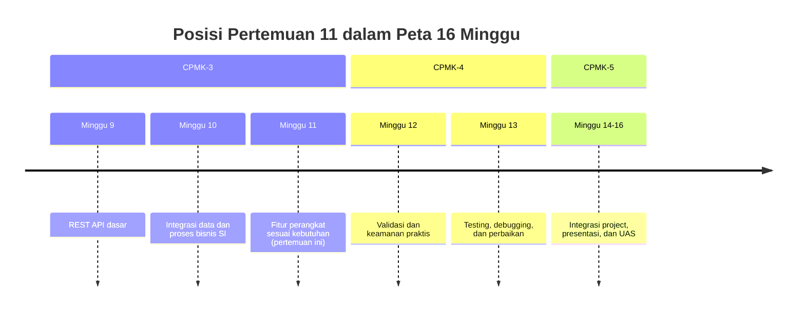
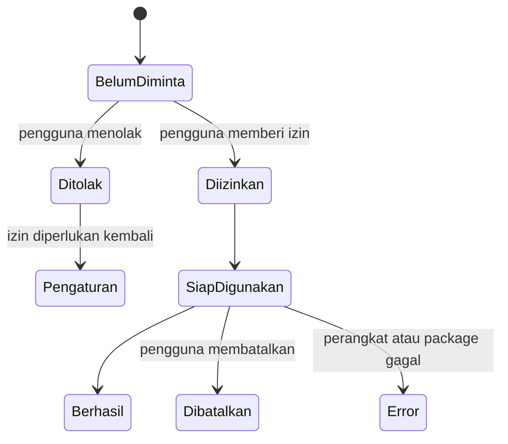
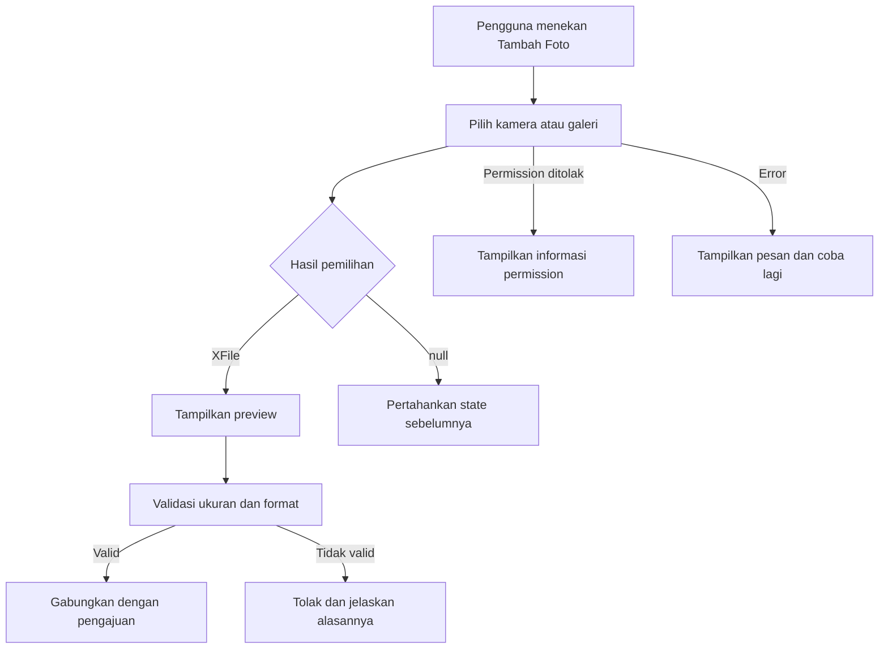

# Pertemuan 11 — Fitur Perangkat Sesuai Kebutuhan

| | |
|:--|:--|
| **Minggu** | 11 |
| **Tanggal** | Rabu, 25 November 2026 (SI-VIIB) / Sabtu, 28 November 2026 (SI-VIIA) |
| **CPMK** | CPMK-3 |
| **Model Pembelajaran** | Case Based Learning / Project Based Learning |
| **Stack** | Flutter + Dart, package sesuai fitur perangkat |
| **Milestone** | M6 — Fitur Perangkat |

> **Catatan penting:** Pertemuan 11 membahas penggunaan fitur perangkat berdasarkan kebutuhan aplikasi. Fitur kamera, lokasi, file, dan notification tidak ditambahkan sebagai hiasan; setiap fitur harus memiliki tujuan pengguna, data keluaran, permission, dan alur penanganan error yang jelas.
>
> **Batas cakupan:** Contoh utama menggunakan `image_picker` untuk memilih gambar dari kamera atau galeri. Kamera langsung, lokasi, file, dan notification dibahas sebagai alternatif analisis. Konfigurasi permission Android/iOS mengikuti dokumentasi package dan target perangkat yang digunakan.

---

## Daftar Isi

- [Pertemuan 11 — Fitur Perangkat Sesuai Kebutuhan](#pertemuan-11--fitur-perangkat-sesuai-kebutuhan)
  - [Daftar Isi](#daftar-isi)
  - [1. Keterkaitan Pertemuan dengan RPS OBE](#1-keterkaitan-pertemuan-dengan-rps-obe)
  - [2. Capaian Pembelajaran Pertemuan](#2-capaian-pembelajaran-pertemuan)
  - [3. Pemantik Kasus: Memilih Fitur Perangkat](#3-pemantik-kasus-memilih-fitur-perangkat)
  - [4. Analisis Kebutuhan Fitur Perangkat](#4-analisis-kebutuhan-fitur-perangkat)
  - [5. Siklus Permission dan Lifecycle](#5-siklus-permission-dan-lifecycle)
  - [6. Fitur Kamera dan Galeri dengan image\_picker](#6-fitur-kamera-dan-galeri-dengan-image_picker)
  - [7. Fitur Lokasi](#7-fitur-lokasi)
  - [8. Fitur File](#8-fitur-file)
  - [9. Fitur Notification](#9-fitur-notification)
  - [10. Service Layer Fitur Perangkat](#10-service-layer-fitur-perangkat)
  - [11. State Loading, Berhasil, Batal, dan Error](#11-state-loading-berhasil-batal-dan-error)
  - [12. Studi Kasus: Lampiran Foto Pengajuan](#12-studi-kasus-lampiran-foto-pengajuan)
  - [13. Latihan Terbimbing: Fitur Lampiran Foto](#13-latihan-terbimbing-fitur-lampiran-foto)
  - [14. Aktivitas Kelompok](#14-aktivitas-kelompok)
  - [15. Latihan Individu](#15-latihan-individu)
  - [16. Pemanfaatan AI sebagai Coding Assistant](#16-pemanfaatan-ai-sebagai-coding-assistant)
  - [17. Kuis Formatif](#17-kuis-formatif)
  - [18. Keluaran Pembelajaran — Tugas 11](#18-keluaran-pembelajaran--tugas-11)
    - [Cara Pengumpulan — Push ke Repository GitHub Kelas](#cara-pengumpulan--push-ke-repository-github-kelas)
  - [19. Rubrik Penilaian](#19-rubrik-penilaian)
  - [20. Verifikasi Kode](#20-verifikasi-kode)
  - [21. Persiapan ke Pertemuan 12](#21-persiapan-ke-pertemuan-12)
    - [📎 Lampiran: Kode Praktikum](#-lampiran-kode-praktikum)

---

## 1. Keterkaitan Pertemuan dengan RPS OBE

Pertemuan 11 melanjutkan **CPMK-3** dengan kemampuan memilih dan menerapkan fitur perangkat yang mendukung proses bisnis Sistem Informasi:

> Mahasiswa mampu mengintegrasikan minimal satu fitur perangkat sesuai kebutuhan aplikasi dan menangani hasil, pembatalan, permission, serta error.

Pertemuan 10 berfokus pada integrasi data dan proses bisnis. Pertemuan 11 menghubungkan proses tersebut dengan kemampuan perangkat yang tersedia pada platform mobile.



---

## 2. Capaian Pembelajaran Pertemuan

Setelah mengikuti pertemuan ini, mahasiswa mampu:

| No. | Kemampuan | Indikator |
|:---:|:----------|:----------|
| 1 | Menganalisis kebutuhan fitur perangkat | Menentukan fitur perangkat berdasarkan aktor, tujuan, dan data keluaran |
| 2 | Menjelaskan permission | Mengidentifikasi permission dan konsekuensinya pada platform target |
| 3 | Menggunakan fitur perangkat | Mengambil atau membaca data perangkat melalui package yang sesuai |
| 4 | Mengelola lifecycle fitur | Menangani loading, berhasil, batal, permission ditolak, dan error |
| 5 | Mengintegrasikan hasil ke proses bisnis | Menyimpan hasil fitur perangkat pada state atau request API sesuai kebutuhan |

---

## 3. Pemantik Kasus: Memilih Fitur Perangkat

Sebuah aplikasi pengajuan fasilitas kampus memerlukan bukti kondisi ruang sebelum pengajuan dikirim. Tim mengusulkan kamera, lokasi, file, dan notification sekaligus tanpa menuliskan tujuan setiap fitur.

Analisis kasus:

- Kamera dapat mengambil foto kondisi ruang.
- Lokasi dapat memeriksa posisi pengguna ketika pengajuan dibuat.
- File dapat memilih dokumen pendukung dari perangkat.
- Notification dapat memberi informasi ketika status pengajuan berubah.

Pertanyaan pemantik:

1. Fitur mana yang benar-benar diperlukan oleh proses bisnis?
2. Data apa yang dihasilkan fitur tersebut?
3. Permission apa yang diperlukan?
4. Apa yang terjadi ketika pengguna menolak permission atau membatalkan pemilihan?
5. Apakah fitur dapat diuji pada target web, atau memerlukan perangkat tertentu?

---

## 4. Analisis Kebutuhan Fitur Perangkat

Gunakan tabel berikut sebelum menambahkan package:

| Fitur | Tujuan pengguna | Data keluaran | Permission/konsekuensi |
|:------|:----------------|:--------------|:-----------------------|
| Kamera | Mengambil foto kondisi ruang | File gambar atau `XFile` | Kamera, pembatalan, akses perangkat |
| Lokasi | Mengisi atau memeriksa lokasi | Latitude dan longitude | Location service dan permission |
| File | Memilih dokumen pendukung | Path atau bytes file | Akses file, format dan ukuran |
| Notification | Memberi informasi status | Event atau pesan | Permission notification dan lifecycle |

Fitur dipilih jika kebutuhan, data keluaran, dan cara pengujiannya sudah jelas. Package tidak boleh ditambahkan hanya karena tersedia pada ekosistem Flutter.

---

## 5. Siklus Permission dan Lifecycle

Fitur perangkat memiliki keadaan yang perlu ditangani:



Pemeriksaan permission dapat berbeda menurut platform. Dokumentasikan platform yang diuji dan jangan menganggap permission selalu tersedia.

---

## 6. Fitur Kamera dan Galeri dengan image_picker

Tambahkan dependency pada `pubspec.yaml`:

```yaml
dependencies:
  flutter:
    sdk: flutter
  image_picker: ^1.1.2
```

Contoh service:

```dart
import 'package:image_picker/image_picker.dart';

class FotoService {
  final ImagePicker _picker = ImagePicker();

  Future<XFile?> ambilFoto() {
    return _picker.pickImage(
      source: ImageSource.camera,
      maxWidth: 1600,
      imageQuality: 80,
    );
  }

  Future<XFile?> pilihDariGaleri() {
    return _picker.pickImage(source: ImageSource.gallery);
  }
}
```

Nilai `null` bukan selalu error. Nilai tersebut dapat berarti pengguna membatalkan kamera atau pemilihan gambar. Widget perlu membedakan pembatalan dari error package.

---

## 7. Fitur Lokasi

Fitur lokasi dapat digunakan jika kebutuhan aplikasi memerlukan koordinat perangkat. Analisis minimal meliputi:

1. apakah location service pada perangkat aktif;
2. apakah aplikasi memiliki permission;
3. apakah pengguna memberikan izin saat runtime;
4. bagaimana aplikasi menangani lokasi yang tidak tersedia;
5. apakah koordinat perlu dikirim ke server dan dilindungi.

Package yang dapat dipertimbangkan adalah `geolocator`. Ikuti dokumentasi package untuk konfigurasi platform karena Android dan iOS memiliki aturan permission yang berbeda.

---

## 8. Fitur File

Fitur file digunakan ketika pengguna perlu memilih atau membaca dokumen. Analisis perlu menentukan:

- jenis file yang diterima;
- batas ukuran file;
- apakah file dikirim ke server atau hanya dibaca lokal;
- bagaimana file yang dibatalkan diperlakukan;
- bagaimana error format dan ukuran ditampilkan.

Package `file_picker` dapat dipertimbangkan untuk pemilihan file. Data file sebaiknya diproses pada service agar widget tidak mengelola detail path, bytes, atau upload secara langsung.

---

## 9. Fitur Notification

Notification sesuai jika proses bisnis memerlukan informasi setelah pengguna meninggalkan halaman aplikasi, misalnya status pengajuan berubah.

Analisis perlu menentukan:

- peristiwa yang memicu notification;
- isi pesan dan tujuan pengguna;
- apakah notification lokal atau push notification;
- permission pada platform target;
- perilaku ketika notification ditekan.

Notification tidak menggantikan status pada server. Status server tetap menjadi sumber data utama, sedangkan notification memberi informasi kepada pengguna agar membuka aplikasi dan memeriksa data terbaru.

---

## 10. Service Layer Fitur Perangkat

Pisahkan package dan lifecycle fitur perangkat dari widget:

```dart
class LampiranFotoService {
  final FotoService _fotoService;

  LampiranFotoService(this._fotoService);

  Future<String?> pilihLampiran() async {
    final foto = await _fotoService.pilihDariGaleri();
    return foto?.path;
  }
}
```

Widget hanya memanggil service, menyimpan hasil pada state, dan menampilkan kondisi halaman. Pemisahan ini membantu pengujian dan memudahkan penggantian sumber data pada masa pengembangan.

---

## 11. State Loading, Berhasil, Batal, dan Error

State fitur perangkat perlu membedakan kondisi berikut:

| Kondisi | Contoh tampilan |
|:--------|:----------------|
| Loading | `CircularProgressIndicator` |
| Berhasil | Preview gambar atau nama file |
| Dibatalkan | Halaman tetap menampilkan data sebelumnya |
| Permission ditolak | Pesan alasan dan instruksi pengaturan |
| Error | Pesan kegagalan dan tombol coba lagi |

Jangan menganggap `null` sebagai error secara langsung pada `image_picker`. `null` biasanya menunjukkan pengguna membatalkan aksi.

---

## 12. Studi Kasus: Lampiran Foto Pengajuan

Skenario: mahasiswa mengajukan peminjaman ruang dan dapat melampirkan foto kondisi ruang. Foto ditampilkan pada halaman, kemudian path atau data yang diperlukan dikirim ke service pengajuan sesuai kemampuan backend.



Kebutuhan harus menjelaskan apakah aplikasi menyimpan foto lokal, mengunggahnya ke server, atau hanya menggunakannya sebagai preview sebelum proses berikutnya.

---

## 13. Latihan Terbimbing: Fitur Lampiran Foto

Latihan terbimbing menggunakan contoh pada [`../code/pertemuan-11/demo-fitur-perangkat-flutter.dart`](../code/pertemuan-11/demo-fitur-perangkat-flutter.dart).

```bash
flutter run -d chrome
```

Kemudian lengkapi latihan pada [`../code/pertemuan-11/latihan-fitur-perangkat-flutter.dart`](../code/pertemuan-11/latihan-fitur-perangkat-flutter.dart).

Periksa hal berikut:

- package tercatat pada `pubspec.yaml`;
- hasil `XFile` disimpan pada state yang tepat;
- pembatalan tidak ditampilkan sebagai error;
- permission atau error ditampilkan secara informatif;
- preview tidak ditampilkan ketika tidak ada file yang dipilih.

---

## 14. Aktivitas Kelompok

Bentuk kelompok 3–4 orang:

1. Pilih satu fitur perangkat yang mendukung kebutuhan project.
2. Tulis tujuan pengguna dan data keluaran fitur.
3. Identifikasi permission dan platform target.
4. Buat state diagram dari kondisi sebelum, selama, dan sesudah penggunaan fitur.
5. Tentukan service yang memisahkan package dari widget.
6. Implementasikan satu skenario berhasil dan satu skenario dibatalkan.
7. Catat keterbatasan pengujian pada target web atau perangkat yang tersedia.

---

## 15. Latihan Individu

Lengkapi latihan fitur perangkat dengan ketentuan berikut:

1. Lengkapi service pemilihan foto dari kamera atau galeri.
2. Tampilkan preview ketika `XFile` berhasil diperoleh.
3. Pertahankan state sebelumnya ketika pengguna membatalkan pemilihan.
4. Tampilkan pesan ketika permission atau package menghasilkan error.
5. Tambahkan validasi format atau ukuran sesuai kebutuhan project.
6. Tulis alasan teknis mengapa fitur tersebut diperlukan.

---

## 16. Pemanfaatan AI sebagai Coding Assistant

**AI assistant (GitHub Copilot, ChatGPT, Claude, Gemini, Cursor) dapat digunakan sebagai alat bantu pembelajaran dengan ketentuan berikut:**

**✅ Gunakan AI untuk:**

- Menjelaskan lifecycle permission dan penggunaan package fitur perangkat.
- Membantu membaca error konfigurasi Android, iOS, atau target web.
- Mereview pemisahan service, widget, dan state halaman.
- Mengusulkan skenario pengujian fitur berhasil, dibatalkan, permission ditolak, dan error.

**❌ Jangan gunakan AI untuk:**

- Menambahkan fitur perangkat tanpa kebutuhan dari project.
- Menyalin konfigurasi permission tanpa memahami platform target.
- Mengabaikan data sensitif, keamanan, atau batasan package.
- Memasukkan token, kredensial, atau data pengguna nyata ke dalam prompt.

**Etika di kelas ini:**

1. Mahasiswa **wajib dapat menjelaskan** alasan pemilihan fitur, permission, service, state, dan penanganan error.
2. Jika memakai AI, **cantumkan** pada komentar kode atau refleksi tugas:

  ```text
  Deklarasi penggunaan AI: GitHub Copilot — membantu membaca error permission
  pada image_picker; konfigurasi platform, penanganan pembatalan, dan pengujian
  dilakukan serta diverifikasi oleh penulis.
  ```

3. AI digunakan sebagai **asisten pembelajaran**, bukan sebagai **pengganti proses analisis dan implementasi**. Mahasiswa tetap bertanggung jawab memeriksa permission, menguji aplikasi, dan menjelaskan hasil implementasi.

---

## 17. Kuis Formatif

Gunakan [Quiz Pertemuan 11](./02-Quiz-Pertemuan-11.md) setelah praktikum. Kuis mengukur analisis kebutuhan fitur perangkat, permission, lifecycle, service, state, dan error handling.

---

## 18. Keluaran Pembelajaran — Tugas 11

**Tugas 11 — Integrasi Fitur Perangkat**

Mahasiswa memilih satu fitur perangkat yang mendukung proses bisnis project dan mengintegrasikannya pada aplikasi Flutter.

Gunakan [Panduan Pengerjaan Tugas 11](./contoh-tugas-11-mahasiswa.md) sebagai checklist pengumpulan. Dokumen tersebut berisi kerangka dan kriteria tugas, bukan contoh jawaban.

Keluaran tugas:

1. Fitur perangkat minimal satu: kamera, lokasi, file, atau notification.
2. Dokumen singkat tujuan fitur, aktor, data keluaran, permission, dan batasan platform.
3. Implementasi service dan halaman yang menggunakan fitur.
4. State loading, berhasil, dibatalkan, permission ditolak, dan error sesuai kebutuhan.
5. Skenario pengujian dan hasil aktual.
6. README konfigurasi dependency dan cara menjalankan.
7. Refleksi penggunaan AI jika AI digunakan.

### Cara Pengumpulan — Push ke Repository GitHub Kelas

Tugas dikumpulkan melalui repository GitHub kelas masing-masing:

| Kelas | Repository | Folder |
|:------|:-----------|:-------|
| SI-VIIB | [SI-VIIB-Mobile](https://github.com/PBWFEND/SI-VIIB-Mobile) | `tugas-11/` |
| SI-VIIA | [SI-VIIA-Mobile](https://github.com/PBWFEND/SI-VIIA-Mobile) | `tugas-11/` |

> Alamat lengkap repository dibagikan melalui kanal kelas. Gunakan repository sesuai kelas Anda.

Jika repository belum tersedia di komputer Anda, gunakan salah satu perintah berikut:

**SI-VIIB:**
```bash
git clone https://github.com/PBWFEND/SI-VIIB-Mobile.git
cd SI-VIIB-Mobile
git checkout <nim>
```

**SI-VIIA:**
```bash
git clone https://github.com/PBWFEND/SI-VIIA-Mobile.git
cd SI-VIIA-Mobile
git checkout <nim>
```

Struktur minimal folder pengumpulan:

```text
tugas-11/
├── lib/
├── pubspec.yaml
├── README.md
├── dokumen-fitur-perangkat.md
├── skenario-pengujian.md
└── refleksi.md
```

Langkah pengumpulan:

1. Masuk ke repository lokal, pastikan berada pada branch `<nim>`, dan buat folder `tugas-11/`:
  ```bash
  git checkout <nim>
  mkdir -p tugas-11
  ```
2. Simpan source code, konfigurasi dependency, dokumen fitur, skenario pengujian, README, dan refleksi pada folder tersebut.
3. Periksa permission, platform target, kondisi berhasil, pembatalan, error, hasil uji, dan deklarasi AI.
4. Commit dan push:

  ```bash
  git add tugas-11
  git commit -m "tugas-11: fitur perangkat - <nama> <nim>"
  git push origin <nim>
  ```

5. Buat Pull Request dari branch tugas ke `main`:
   ```bash
  gh pr create --base main --head <nim> --title "Tugas 11: Fitur Perangkat - <nama> <nim>" --body "Pengumpulan Tugas 11 dan refleksi."
   ```
  Jika GitHub CLI tidak tersedia, gunakan tombol **Compare & pull request** pada repository GitHub dengan `base: main` dan `compare: <nim>`.
6. Buka Pull Request di browser dan pastikan folder tugas serta seluruh berkas dapat dibaca sebelum tenggat.

---

## 19. Rubrik Penilaian

| Kriteria | Bobot | 4 (Sangat Baik) | 3 (Baik) | 2 (Cukup) | 1 (Perlu Bimbingan) |
|:---------|:-----:|:----------------|:---------|:----------|:--------------------|
| Alasan fitur | 20% | Fitur memiliki tujuan proses bisnis dan batasan platform yang jelas | Tujuan jelas, batasan sebagian | Tujuan masih umum | Fitur tidak berkaitan dengan project |
| Implementasi | 30% | Fitur berjalan dan dipisahkan melalui service | Fitur berjalan dengan kesalahan minor | Fitur hanya sebagian berjalan | Fitur tidak dapat diuji |
| Permission dan lifecycle | 20% | Permission, batal, dan error ditangani sesuai platform | Sebagian kondisi ditangani | Kondisi terbatas | Tidak ada penanganan |
| Integrasi UI dan proses | 15% | Hasil fitur digunakan pada alur aplikasi | Hasil ditampilkan tetapi belum terhubung penuh | Hanya preview atau demonstrasi | Tidak terhubung |
| Dokumentasi dan pengujian | 15% | README, skenario, dan hasil uji lengkap | Dokumentasi cukup | Dokumentasi terbatas | Tidak ada bukti pengujian |

---

## 20. Verifikasi Kode

```bash
flutter pub get
flutter analyze
flutter run -d chrome
```

Jika fitur membutuhkan perangkat atau permission yang tidak tersedia pada target web, gunakan target perangkat sesuai panduan dan dokumentasikan target pengujian.

Checklist:

- [ ] Dependency tercatat pada `pubspec.yaml`.
- [ ] Permission platform dikonfigurasi sesuai dokumentasi package.
- [ ] Service dan widget memiliki tanggung jawab terpisah.
- [ ] Fitur berhasil, dibatalkan, dan error diuji.
- [ ] Data sensitif tidak dicantumkan pada source code.
- [ ] Cara menjalankan ditulis pada README.

---

## 21. Persiapan ke Pertemuan 12

Pada Pertemuan 12, mahasiswa akan mempelajari validasi dan keamanan praktis.

Persiapkan hal berikut:

- tinjau kembali permission dan data sensitif dari fitur perangkat;
- identifikasi input yang perlu divalidasi sebelum dikirim ke server;
- periksa apakah project membutuhkan HTTPS, token, atau secure storage;
- catat dependency yang digunakan dan alasan teknisnya;
- siapkan daftar risiko keamanan pada fitur yang dipilih.

---

### 📎 Lampiran: Kode Praktikum

| File | Keterangan |
|:-----|:-----------|
| [`code/pertemuan-11/demo-fitur-perangkat-flutter.dart`](../code/pertemuan-11/demo-fitur-perangkat-flutter.dart) | Demo fitur kamera/galeri dengan `image_picker` |
| [`code/pertemuan-11/latihan-fitur-perangkat-flutter.dart`](../code/pertemuan-11/latihan-fitur-perangkat-flutter.dart) | Latihan terbimbing fitur perangkat dengan TODO |
