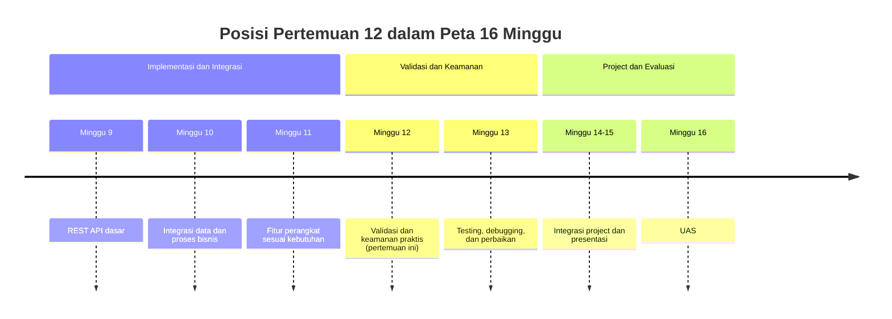
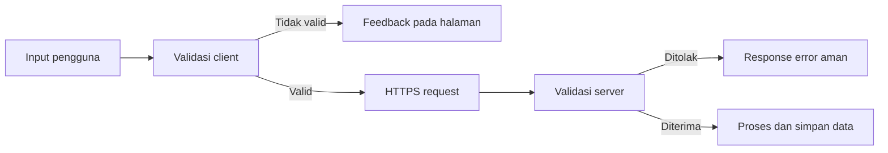
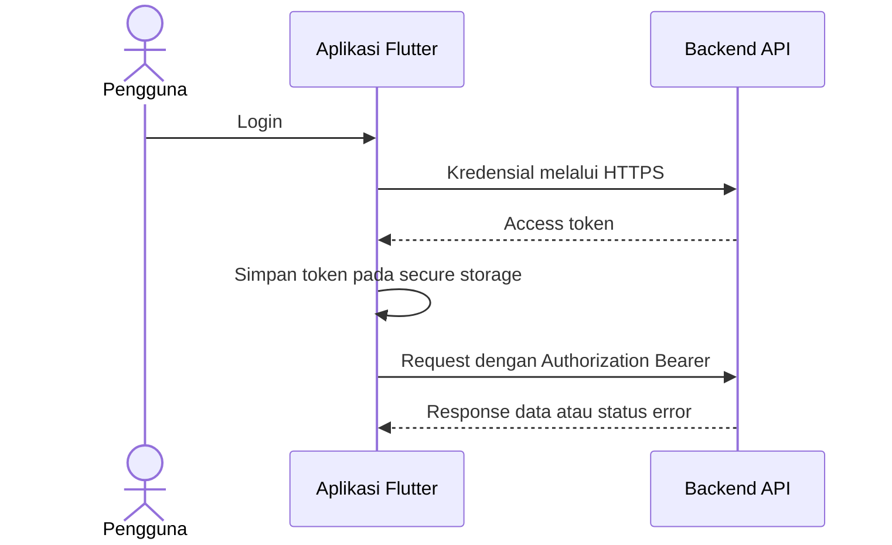
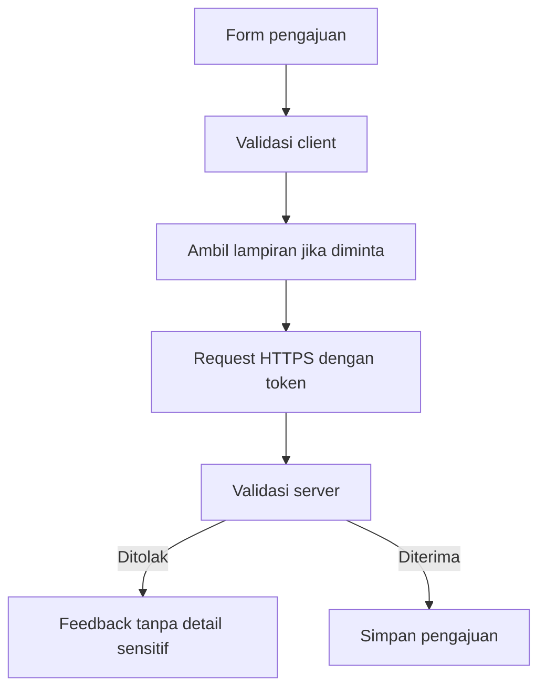

# Pertemuan 12 — Validasi dan Keamanan Praktis

| | |
|:--|:--|
| **Minggu** | 12 |
| **Tanggal** | Rabu, 2 Desember 2026 (SI-VIIB) / Sabtu, 5 Desember 2026 (SI-VIIA) |
| **CPMK** | CPMK-4 |
| **Model Pembelajaran** | Case Based Learning / Project Based Learning |
| **Stack** | Flutter + Dart, validasi input, HTTPS, token, permission, secure storage |
| **Milestone** | M7 — Validasi dan Keamanan Praktis |

> **Catatan penting:** Pertemuan 12 membahas validasi input dan keamanan praktis pada aplikasi mobile. Anda akan membedakan validasi pada halaman dengan pemeriksaan pada server, memahami penggunaan HTTPS dan token, meninjau permission fitur perangkat, serta menyusun security checklist yang sesuai dengan kebutuhan project.
>
> **Batas cakupan:** Contoh utama menggunakan validasi form, pemeriksaan konfigurasi, dan checklist keamanan tanpa menyimpan kredensial nyata. Package `flutter_secure_storage` dan permission platform dibahas sebagai strategi implementasi; konfigurasi production, threat modeling mendalam, dan audit keamanan formal berada di luar cakupan pertemuan ini.

---

## Daftar Isi

- [Pertemuan 12 — Validasi dan Keamanan Praktis](#pertemuan-12--validasi-dan-keamanan-praktis)
  - [Daftar Isi](#daftar-isi)
  - [1. Keterkaitan Pertemuan dengan RPS OBE](#1-keterkaitan-pertemuan-dengan-rps-obe)
  - [2. Capaian Pembelajaran Pertemuan](#2-capaian-pembelajaran-pertemuan)
  - [3. Pemantik Kasus: Data Valid Belum Tentu Aman](#3-pemantik-kasus-data-valid-belum-tentu-aman)
  - [4. Validasi Client dan Server](#4-validasi-client-dan-server)
  - [5. Validasi Input pada Flutter](#5-validasi-input-pada-flutter)
    - [5.1 Validator Form](#51-validator-form)
    - [5.2 Sanitasi dan Batas Input](#52-sanitasi-dan-batas-input)
  - [6. HTTPS dan Perlindungan Data dalam Perjalanan](#6-https-dan-perlindungan-data-dalam-perjalanan)
  - [7. Token dan Secure Storage](#7-token-dan-secure-storage)
  - [8. Permission dan Prinsip Least Privilege](#8-permission-dan-prinsip-least-privilege)
  - [9. Security Checklist Project](#9-security-checklist-project)
  - [10. Case Based Learning: Pengajuan yang Aman](#10-case-based-learning-pengajuan-yang-aman)
  - [11. Aktivitas Kelompok](#11-aktivitas-kelompok)
  - [12. Latihan Individu](#12-latihan-individu)
  - [13. Pemanfaatan AI sebagai Coding Assistant](#13-pemanfaatan-ai-sebagai-coding-assistant)
  - [14. Kuis Formatif](#14-kuis-formatif)
  - [15. Keluaran Pembelajaran — Tugas 12](#15-keluaran-pembelajaran--tugas-12)
  - [16. Rubrik Tugas 12](#16-rubrik-tugas-12)
  - [17. Verifikasi Kode](#17-verifikasi-kode)
  - [18. Persiapan ke Pertemuan 13](#18-persiapan-ke-pertemuan-13)
  - [Referensi Terkait](#referensi-terkait)
  - [Lampiran: Kode Praktikum](#lampiran-kode-praktikum)

---

## 1. Keterkaitan Pertemuan dengan RPS OBE

Pertemuan 12 mendukung **CPMK-4**:

> Mahasiswa mampu menerapkan validasi input dan keamanan praktis pada aplikasi bergerak sesuai kebutuhan serta risiko yang teridentifikasi.

Pertemuan 9–11 memperkenalkan REST API, integrasi proses bisnis, dan fitur perangkat. Pertemuan 12 menambahkan pemeriksaan agar data yang dikirim, token yang digunakan, dan permission fitur dikelola secara lebih bertanggung jawab.



---

## 2. Capaian Pembelajaran Pertemuan

Setelah mengikuti pertemuan ini, mahasiswa mampu:

| No. | Kemampuan | Indikator |
|:---:|:----------|:----------|
| 1 | Membedakan validasi client dan server | Menjelaskan peran masing-masing dan alasan server tetap melakukan pemeriksaan ulang |
| 2 | Menerapkan validasi input | Menolak input kosong, format salah, dan nilai di luar batas |
| 3 | Menjelaskan HTTPS dan token | Menjelaskan perlindungan data saat dikirim serta fungsi token pada request |
| 4 | Mengelola permission | Menentukan permission berdasarkan kebutuhan fitur dan menangani penolakan |
| 5 | Menyusun security checklist | Mengidentifikasi risiko dasar, mitigasi, status pemeriksaan, dan bukti verifikasi |
| 6 | Mendokumentasikan keputusan keamanan | Menjelaskan data sensitif, batasan implementasi, dan rencana perbaikan project |

---

## 3. Pemantik Kasus: Data Valid Belum Tentu Aman

Sebuah aplikasi pengajuan ruang sudah menolak nama kosong dan tanggal yang salah. Namun, aplikasi masih mengirim request melalui HTTP, menyimpan token pada log, dan meminta permission kamera meskipun fitur foto tidak digunakan.

Pertanyaan pemantik:

1. Mengapa validasi pada form tidak menggantikan validasi server?
2. Apa risiko jika request berisi token dikirim tanpa HTTPS?
3. Di mana token sebaiknya disimpan pada perangkat?
4. Mengapa permission harus diminta berdasarkan kebutuhan fitur?
5. Bukti apa yang dapat menunjukkan bahwa pemeriksaan keamanan sudah dilakukan?

Keamanan praktis dimulai dari keputusan yang dapat dijelaskan dan diverifikasi, bukan hanya dari penambahan package.

---

## 4. Validasi Client dan Server

| Lokasi | Tujuan | Contoh pemeriksaan | Keterbatasan |
|:-------|:-------|:-------------------|:-------------|
| Client/mobile | Memberikan feedback cepat dan mencegah request yang jelas salah | Field wajib, format email, panjang teks | Client dapat dimodifikasi; tidak boleh menjadi satu-satunya perlindungan |
| Server/API | Menjadi pemeriksaan otoritatif sebelum data diproses | Hak akses, tipe data, aturan bisnis, identifier | Membutuhkan response error yang jelas dan aman |

Alur yang disarankan:



Validasi client memperbaiki pengalaman penggunaan. Validasi server melindungi proses bisnis meskipun request datang dari client lain.

---

## 5. Validasi Input pada Flutter

### 5.1 Validator Form

Gunakan `Form`, `GlobalKey<FormState>`, dan `TextFormField` untuk memeriksa input sebelum request dikirim:

```dart
final formKey = GlobalKey<FormState>();

Form(
  key: formKey,
  child: TextFormField(
    decoration: const InputDecoration(labelText: 'Nama pemohon'),
    validator: (value) {
      final nama = value?.trim() ?? '';
      if (nama.isEmpty) {
        return 'Nama pemohon wajib diisi';
      }
      if (nama.length > 100) {
        return 'Nama pemohon maksimal 100 karakter';
      }
      return null;
    },
  ),
)
```

Saat tombol dikirim:

```dart
if (!(formKey.currentState?.validate() ?? false)) {
  return;
}
// Bentuk request hanya setelah seluruh validator lulus.
```

Validator sebaiknya menjelaskan masalah dan tindakan perbaikannya. Jangan menampilkan detail internal server pada pesan untuk pengguna.

### 5.2 Sanitasi dan Batas Input

Sebelum data dipakai:

- gunakan `trim()` untuk menghapus spasi yang tidak diperlukan;
- tentukan batas panjang teks;
- gunakan tipe data yang sesuai;
- jangan menyimpan password atau token pada message error;
- jangan menganggap sanitasi client sudah cukup untuk mencegah injection pada server.

| Input | Pemeriksaan client | Pemeriksaan server |
|:------|:-------------------|:-------------------|
| Nama | Tidak kosong, panjang maksimum | Tipe, panjang, dan aturan karakter |
| Email | Format dasar | Format, keunikan, dan status akun |
| Tanggal | Format dan rentang tanggal | Aturan periode dan bentrokan jadwal |
| File foto | Format dan ukuran | Tipe, ukuran, dan isi file |

---

## 6. HTTPS dan Perlindungan Data dalam Perjalanan

HTTPS mengenkripsi komunikasi antara client dan server menggunakan TLS. Gunakan endpoint `https://` untuk request yang membawa data akun, token, atau informasi pengajuan.

Checklist HTTPS:

- endpoint production menggunakan `https://`;
- sertifikat server valid;
- token tidak dikirim melalui query string;
- URL debug tidak berisi kredensial;
- log tidak mencetak header `Authorization` atau body sensitif;
- error sertifikat tidak dilewati dengan konfigurasi yang melemahkan keamanan.

HTTPS melindungi perjalanan data, tetapi tidak memperbaiki validasi atau hak akses yang salah. Lapisan keamanan perlu diperiksa secara terpisah.

---

## 7. Token dan Secure Storage

Token membuktikan konteks akses pada request berikutnya. Token bukan pengganti password hashing dan tidak boleh diperlakukan sebagai data biasa.

Alur umum:



Prinsip implementasi:

- simpan token pada penyimpanan aman platform, misalnya `flutter_secure_storage`;
- jangan menyimpan token pada source code, screenshot, atau log;
- gunakan masa berlaku token yang sesuai kebijakan backend;
- hapus token saat logout;
- tangani token kedaluwarsa dengan alur login ulang atau refresh sesuai kontrak backend;
- jangan menganggap token yang tersimpan otomatis membuat endpoint aman.

Contoh API konseptual:

```dart
abstract class TokenStorage {
  Future<void> simpan(String token);
  Future<String?> baca();
  Future<void> hapus();
}
```

Konfigurasi platform package harus mengikuti dokumentasi resmi. Jangan menyalin permission atau konfigurasi tanpa memahami dampaknya.

---

## 8. Permission dan Prinsip Least Privilege

Minta permission hanya jika fitur yang dipilih memang memerlukannya. Prinsip **least privilege** berarti aplikasi memperoleh akses minimum yang diperlukan untuk menjalankan fungsi.

| Fitur | Permission yang mungkin | Kondisi yang harus ditangani |
|:------|:------------------------|:-----------------------------|
| Kamera | Kamera | Permission ditolak, pembatalan, perangkat tidak tersedia |
| Lokasi | Lokasi | Service lokasi mati, izin ditolak, posisi tidak tersedia |
| File | Akses pemilihan file | Format tidak sesuai, ukuran terlalu besar, pembatalan |
| Notification | Notification | Izin ditolak, notification tidak relevan, lifecycle aplikasi |

Urutan pemeriksaan:

1. jelaskan tujuan permission kepada pengguna;
2. minta permission saat fitur digunakan, bukan saat aplikasi baru dibuka tanpa alasan;
3. tangani izin ditolak dengan informasi yang jelas;
4. sediakan jalur penggunaan yang tidak bergantung pada fitur jika memungkinkan;
5. catat platform dan target pengujian.

---

## 9. Security Checklist Project

Gunakan checklist berikut. Kolom bukti harus diisi dengan file, screenshot, test, atau hasil pemeriksaan yang benar-benar tersedia.

| No. | Pemeriksaan | Status | Bukti |
|:---:|:------------|:------:|:------|
| 1 | Input wajib dan format dasar divalidasi pada client | | |
| 2 | Server tetap menjadi pemeriksa aturan bisnis | | |
| 3 | Endpoint yang membawa data sensitif memakai HTTPS | | |
| 4 | Token tidak ditulis pada source code atau log | | |
| 5 | Token disimpan menggunakan mekanisme aman | | |
| 6 | Permission hanya diminta sesuai fitur | | |
| 7 | Kondisi permission ditolak dan pembatalan ditangani | | |
| 8 | Pesan error tidak menampilkan kredensial atau detail internal | | |
| 9 | Dependency dan permission terdokumentasi | | |
| 10 | Batasan keamanan dan rencana perbaikan ditulis | | |

Checklist bukan bukti bahwa aplikasi bebas risiko. Checklist membantu tim menunjukkan pemeriksaan yang sudah dilakukan dan pekerjaan yang masih perlu dilanjutkan.

---

## 10. Case Based Learning: Pengajuan yang Aman

Kasus: aplikasi pengajuan ruang menerima nama pemohon, tanggal, foto kondisi ruang, dan token login. Tim harus menambahkan validasi, mengirim request melalui HTTPS, menyimpan token secara aman, serta meminta permission foto hanya ketika pengguna menekan tombol lampiran.

Tugas analisis kelompok:

1. tentukan data yang sensitif;
2. tulis validasi client dan pemeriksaan server yang diperlukan;
3. tentukan permission yang diperlukan dan kondisi penolakannya;
4. buat alur logout dan penghapusan token;
5. isi security checklist dengan bukti yang dapat diperiksa.



---

## 11. Aktivitas Kelompok

Bentuk kelompok yang terdiri atas 3–4 mahasiswa:

1. pilih satu fitur project yang membawa data pengguna;
2. identifikasi data sensitif, permission, dan risiko yang mungkin terjadi;
3. susun tabel validasi client/server;
4. buat security checklist dan bukti pemeriksaannya;
5. presentasikan satu keputusan keamanan dan konsekuensinya;
6. tinjau checklist kelompok lain dengan fokus pada data yang belum terlindungi.

**Target:** setiap kelompok menghasilkan satu security checklist, satu tabel validasi, dan satu alur penanganan kondisi gagal.

---

## 12. Latihan Individu

Gunakan contoh pada [`../code/pertemuan-12/validasi-keamanan-flutter.dart`](../code/pertemuan-12/validasi-keamanan-flutter.dart), lalu lengkapi scaffold [`../code/pertemuan-12/latihan-keamanan-flutter.dart`](../code/pertemuan-12/latihan-keamanan-flutter.dart).

1. Tambahkan validator nama, email, dan tanggal.
2. Tolak input kosong dan input yang melebihi batas panjang.
3. Tulis tiga pemeriksaan keamanan yang relevan untuk project Anda.
4. Tentukan permission yang benar-benar diperlukan.
5. Isi bukti pada security checklist.
6. Jelaskan mengapa token tidak boleh disimpan pada `shared_preferences` untuk kebutuhan rahasia.

---

## 13. Pemanfaatan AI sebagai Coding Assistant

**AI assistant (GitHub Copilot, ChatGPT, Claude, Gemini, Cursor) dapat digunakan sebagai alat bantu pembelajaran dengan ketentuan berikut:**

**✅ Gunakan AI untuk:**

- Menjelaskan perbedaan validasi client dan server.
- Membantu membaca pesan error validator atau permission.
- Mereview security checklist berdasarkan kebutuhan project.
- Mengusulkan skenario pengujian token kedaluwarsa dan permission ditolak.

**❌ Jangan gunakan AI untuk:**

- Memasukkan token, password, data pribadi, atau source code sensitif ke dalam prompt.
- Menyalin konfigurasi secure storage atau permission tanpa memahami platform target.
- Menganggap aplikasi aman hanya karena checklist dibuat.
- Menghasilkan seluruh tugas tanpa dapat menjelaskan alasan setiap pemeriksaan.

**Etika di kelas ini:**

1. Anda **wajib dapat menjelaskan** validasi, HTTPS, token, secure storage, permission, dan batasan keamanan yang ditulis.
2. Jika memakai AI, **cantumkan** pada komentar kode atau refleksi tugas:

   ```text
   Deklarasi penggunaan AI: GitHub Copilot — membantu menyusun daftar
   skenario validasi; aturan data, pengujian, dan security checklist
   diverifikasi oleh penulis.
   ```

3. AI digunakan sebagai **asisten pembelajaran**, bukan sebagai **pengganti proses analisis dan verifikasi keamanan**. Anda tetap bertanggung jawab atas keputusan dan kode yang dikumpulkan.

---

## 14. Kuis Formatif

**Kuis formatif (10 menit, dikerjakan tanpa membuka catatan):**

1. Mengapa validasi client tidak menggantikan validasi server?
2. Apa manfaat HTTPS bagi request yang membawa token?
3. Mengapa token tidak boleh ditulis pada source code atau log?
4. Jelaskan prinsip least privilege pada permission kamera atau lokasi.
5. Apa perbedaan `401` dan `403` dalam konteks token dan hak akses?
6. Sebutkan minimal tiga item security checklist dan bukti pemeriksaannya.

---

## 15. Keluaran Pembelajaran — Tugas 12

**Tugas 12 — Security Checklist dan Validasi Project** (dikumpulkan sebelum Pertemuan 13).

Gunakan domain Sistem Informasi yang sama dengan Tugas 1–11. Kerjakan:

1. **Buat file `security-checklist.md`** berisi minimal 10 pemeriksaan, status, dan bukti.
2. **Buat file `validasi-input.md`** berisi minimal lima input, aturan validasi client, pemeriksaan server, dan pesan error.
3. **Perbarui kode project** dengan minimal tiga validator yang dapat dijalankan.
4. **Dokumentasikan token dan permission** yang digunakan atau jelaskan mengapa fitur tersebut belum diperlukan.
5. **Buat file `README.md`** berisi cara menjalankan, dependency, batasan keamanan, dan deklarasi penggunaan AI.
6. **Refleksi tiga kalimat** tentang risiko paling penting pada project dan keputusan mitigasinya.

**Cara Pengumpulan — Push ke Repository GitHub Kelas**

| Kelas | Repository | Folder |
|:------|:-----------|:-------|
| SI-VIIB | [SI-VIIB-Mobile](https://github.com/PBWFEND/SI-VIIB-Mobile) | `tugas-12/` |
| SI-VIIA | [SI-VIIA-Mobile](https://github.com/PBWFEND/SI-VIIA-Mobile) | `tugas-12/` |

**SI-VIIB:**
```bash
git clone https://github.com/PBWFEND/SI-VIIB-Mobile.git
cd SI-VIIB-Mobile
git checkout <nim>
```

**SI-VIIA:**
```bash
git clone https://github.com/PBWFEND/SI-VIIA-Mobile.git
cd SI-VIIA-Mobile
git checkout <nim>
```

1. Pastikan branch aktif adalah `<nim>`, lalu buat folder `tugas-12/`.
2. Simpan `security-checklist.md`, `validasi-input.md`, kode project, `README.md`, dan refleksi pada folder tersebut.
3. Jalankan validasi dan isi kolom bukti sebelum commit.
4. Commit dan push:

   ```bash
   git add tugas-12
   git commit -m "tugas-12: validasi dan keamanan praktis - <nama> <nim>"
   git push origin <nim>
   ```

5. Buat Pull Request ke `main`:

   ```bash
   gh pr create --base main --head <nim> --title "Tugas 12: Validasi dan Keamanan - <nama> <nim>" --body "Pengumpulan security checklist dan validasi project."
   ```

   Jika GitHub CLI tidak tersedia, gunakan **Compare & pull request** dengan `base: main` dan `compare: <nim>`.

6. Pastikan Pull Request dan berkas tugas dapat dibaca sebelum tenggat.

---

## 16. Rubrik Tugas 12

| Kriteria | Bobot | 4 (Sangat Baik) | 3 (Baik) | 2 (Cukup) | 1 (Perlu Bimbingan) |
|:---------|:-----:|:----------------|:---------|:----------|:--------------------|
| Validasi input | 25% | Minimal lima input memiliki aturan, validator, dan pesan yang tepat | Aturan cukup lengkap, terdapat kekurangan minor | Validasi hanya sebagian | Tidak ada validasi yang dapat diuji |
| Security checklist | 25% | Minimal 10 pemeriksaan memiliki status dan bukti yang dapat diverifikasi | Checklist cukup, sebagian bukti belum jelas | Checklist terbatas | Tidak ada checklist |
| HTTPS, token, dan permission | 20% | Keputusan sesuai kebutuhan dan risiko dijelaskan | Keputusan ada, alasan belum lengkap | Pembahasan masih umum | Tidak ada pembahasan |
| Implementasi dan pengujian | 15% | Minimal tiga validator berjalan dan kondisi gagal diuji | Validator berjalan, skenario terbatas | Kode sebagian berjalan | Tidak dapat diuji |
| Dokumentasi, refleksi, dan ketepatan waktu | 15% | Berkas lengkap, refleksi logis, dan tepat waktu | Berkas cukup lengkap | Berkas atau refleksi terbatas | Tidak lengkap atau terlambat |

**Nilai = Σ(bobot × skor) / 16 × 100.** Pengumpulan terlambat: pengurangan 1 level rubrik per hari.

---

## 17. Verifikasi Kode

```bash
flutter pub get
flutter analyze
flutter run -d chrome
```

Checklist verifikasi:

- [ ] Validator menolak input kosong dan format salah.
- [ ] Pesan error tidak memuat token atau data sensitif.
- [ ] Endpoint yang digunakan untuk data sensitif memakai HTTPS.
- [ ] Token tidak ditulis pada source code atau log.
- [ ] Permission sesuai kebutuhan fitur.
- [ ] Kondisi permission ditolak dapat diuji.
- [ ] `flutter analyze` tidak menghasilkan error.
- [ ] Security checklist memiliki bukti pemeriksaan.

Jika fitur membutuhkan perangkat atau permission yang tidak tersedia pada target web, gunakan target perangkat sesuai panduan dan dokumentasikan target pengujian.

---

## 18. Persiapan ke Pertemuan 13

Pada Pertemuan 13, mahasiswa akan mempelajari testing, debugging, dan perbaikan aplikasi.

Persiapkan hal berikut:

- pilih minimal lima skenario pengujian dari validasi dan security checklist;
- siapkan satu skenario error yang dapat direproduksi;
- tinjau cara membaca pesan analyzer dan stack trace;
- catat bug atau risiko yang perlu diperbaiki;
- pastikan project dapat dijalankan dari branch NIM dan Pull Request.

## Referensi Terkait

- [Flutter — Build a form with validation](https://docs.flutter.dev/cookbook/forms/validation) — penggunaan `Form`, `GlobalKey<FormState>`, dan validator.
- [Flutter — Networking](https://docs.flutter.dev/cookbook/networking) — pola komunikasi aplikasi Flutter dengan backend.
- [flutter_secure_storage — pub.dev](https://pub.dev/packages/flutter_secure_storage) — penyimpanan nilai sensitif menggunakan mekanisme aman platform.
- [Flutter — Packages and plugins](https://docs.flutter.dev/packages-and-plugins/using-packages) — cara menambahkan dan meninjau package Flutter.
- [OWASP — Mobile Application Security](https://owasp.org/www-project-mobile-top-10/) — risiko keamanan mobile sebagai bahan pengenalan dan diskusi.

---

### Lampiran: Kode Praktikum

| Berkas | Keterangan |
|:-------|:-----------|
| [`validasi-keamanan-flutter.dart`](../code/pertemuan-12/validasi-keamanan-flutter.dart) | Demo validator input dan security checklist sederhana |
| [`latihan-keamanan-flutter.dart`](../code/pertemuan-12/latihan-keamanan-flutter.dart) | Scaffold latihan validasi dan pemeriksaan keamanan |
