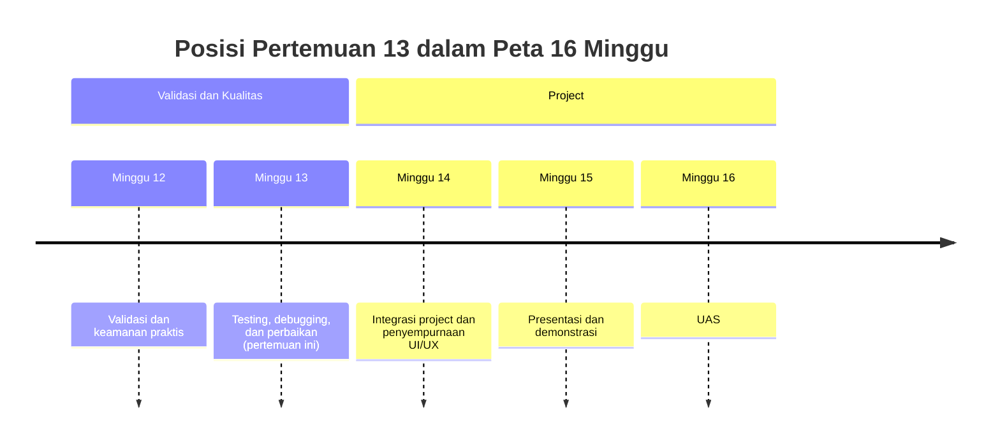
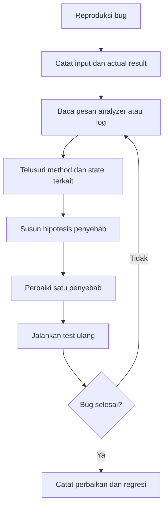

# Pertemuan 13 — Testing, Debugging, dan Perbaikan

| | |
|:--|:--|
| **Minggu** | 13 |
| **Tanggal** | Rabu, 9 Desember 2026 (SI-VIIB) / Sabtu, 12 Desember 2026 (SI-VIIA) |
| **CPMK** | CPMK-4 |
| **Model Pembelajaran** | Case Based Learning / Project Based Learning / Praktikum |
| **Stack** | Flutter + Dart, `flutter_test`, `flutter analyze` |
| **Milestone** | M8 — Testing dan Bug Fixes |

> **Catatan penting:** Pertemuan 13 membahas pengujian fungsional, debugging, dan perbaikan bug pada project. Anda akan menulis test case, menjalankan pemeriksaan analyzer dan test, membaca pesan error, memperbaiki penyebab masalah, lalu mencatat hasil aktual.
>
> **Batas cakupan:** Materi berfokus pada functional testing, widget test sederhana, debugging melalui pesan analyzer dan log, serta perbaikan regresi kecil. Integration test, performance profiling mendalam, dan continuous integration dibahas sebagai pengembangan project lanjutan.

---

## Daftar Isi

- [Pertemuan 13 — Testing, Debugging, dan Perbaikan](#pertemuan-13--testing-debugging-dan-perbaikan)
  - [Daftar Isi](#daftar-isi)
  - [1. Keterkaitan Pertemuan dengan RPS OBE](#1-keterkaitan-pertemuan-dengan-rps-obe)
  - [2. Capaian Pembelajaran Pertemuan](#2-capaian-pembelajaran-pertemuan)
  - [3. Pemantik Kasus: Fitur Berjalan Belum Berarti Benar](#3-pemantik-kasus-fitur-berjalan-belum-berarti-benar)
  - [4. Test Case dan Expected Result](#4-test-case-dan-expected-result)
  - [5. Jenis Testing pada Flutter](#5-jenis-testing-pada-flutter)
  - [6. Widget Test dengan flutter_test](#6-widget-test-dengan-flutter_test)
  - [7. Debugging Berbasis Bukti](#7-debugging-berbasis-bukti)
  - [8. Perbaikan Bug dan Regresi](#8-perbaikan-bug-dan-regresi)
  - [9. Case Based Learning: Pengujian Pengajuan Ruang](#9-case-based-learning-pengujian-pengajuan-ruang)
  - [10. Aktivitas Kelompok](#10-aktivitas-kelompok)
  - [11. Latihan Individu](#11-latihan-individu)
  - [12. Pemanfaatan AI sebagai Coding Assistant](#12-pemanfaatan-ai-sebagai-coding-assistant)
  - [13. Kuis Formatif](#13-kuis-formatif)
  - [14. Keluaran Pembelajaran — Tugas 13](#14-keluaran-pembelajaran--tugas-13)
  - [15. Rubrik Tugas 13](#15-rubrik-tugas-13)
  - [16. Verifikasi Kode](#16-verifikasi-kode)
  - [17. Persiapan ke Pertemuan 14](#17-persiapan-ke-pertemuan-14)
  - [Referensi Terkait](#referensi-terkait)
  - [Lampiran: Kode Praktikum](#lampiran-kode-praktikum)

---

## 1. Keterkaitan Pertemuan dengan RPS OBE

Pertemuan 13 mendukung **CPMK-4**:

> Mahasiswa mampu menguji, menemukan, dan memperbaiki masalah pada aplikasi bergerak berdasarkan hasil pengujian.

Pertemuan 12 menghasilkan validasi dan security checklist. Pada pertemuan ini, validasi tersebut diuji melalui skenario normal dan gagal agar bug dapat ditemukan sebelum project diintegrasikan lebih lanjut.



---

## 2. Capaian Pembelajaran Pertemuan

Setelah mengikuti pertemuan ini, mahasiswa mampu:

| No. | Kemampuan | Indikator |
|:---:|:----------|:----------|
| 1 | Menyusun test case | Menentukan kondisi awal, input, langkah, expected result, dan actual result |
| 2 | Menerapkan functional testing | Menguji alur utama dan kondisi gagal berdasarkan kebutuhan |
| 3 | Menulis widget test sederhana | Menemukan widget, memasukkan input, menekan tombol, dan memeriksa hasil |
| 4 | Melakukan debugging | Menggunakan pesan analyzer, log, dan reproduksi skenario untuk menemukan penyebab |
| 5 | Memperbaiki bug | Mengubah kode pada sumber masalah dan menjalankan test regresi |
| 6 | Mendokumentasikan hasil | Mencatat bug, perbaikan, status test, dan risiko yang masih tersisa |

---

## 3. Pemantik Kasus: Fitur Berjalan Belum Berarti Benar

Sebuah form pengajuan dapat dibuka dan tombol kirim dapat ditekan. Namun, pengujian menemukan beberapa masalah:

- input kosong tetap masuk ke daftar;
- tombol kirim dapat ditekan dua kali sehingga data ganda;
- data sudah berubah tetapi halaman belum memperbarui daftar;
- tombol hapus menghapus item yang berbeda setelah urutan daftar berubah;
- pesan error tidak menjelaskan tindakan perbaikan.

Pertanyaan pemantik:

1. Skenario apa yang harus diuji sebelum fitur dinyatakan selesai?
2. Apa perbedaan expected result dan actual result?
3. Bagaimana menemukan penyebab data ganda?
4. Mengapa bug yang sudah diperbaiki perlu diuji kembali?
5. Bukti apa yang perlu dicatat dalam laporan bug?

---

## 4. Test Case dan Expected Result

Test case mengubah kebutuhan menjadi skenario yang dapat diperiksa.

| ID | Skenario | Kondisi awal | Input | Expected result | Actual result | Status |
|:---|:---------|:-------------|:------|:----------------|:--------------|:------:|
| TC-01 | Form valid | Form kosong | Semua field valid | Data tersimpan satu kali | | |
| TC-02 | Field wajib kosong | Form kosong | Nama kosong | Pesan validasi tampil | | |
| TC-03 | Format email salah | Form terbuka | `nama@` | Request tidak dikirim | | |
| TC-04 | Tombol ditekan dua kali | Form valid | Dua tap cepat | Hanya satu data dibuat | | |
| TC-05 | Data dihapus | Item tersedia | Konfirmasi hapus | Item hilang dari daftar | | |
| TC-06 | Permission ditolak | Fitur foto dibuka | Tolak permission | Pesan dan pilihan pemulihan tampil | | |

Expected result ditulis sebelum pengujian. Actual result diisi setelah skenario benar-benar dijalankan.

---

## 5. Jenis Testing pada Flutter

| Jenis | Fokus | Contoh |
|:------|:------|:-------|
| Static analysis | Masalah sintaks, tipe, dan lint | `flutter analyze` |
| Unit test | Fungsi atau class terisolasi | Validator email mengembalikan pesan yang tepat |
| Widget test | Widget dan interaksi halaman | Tap tombol lalu periksa teks hasil |
| Integration test | Alur aplikasi pada target | Form dibuka, diisi, dikirim, dan daftar diperbarui |
| Manual functional test | Skenario pengguna | Menguji kondisi permission ditolak pada perangkat |

Mulai dari static analysis dan unit/widget test. Gunakan manual test untuk fitur yang bergantung pada perangkat atau permission.

---

## 6. Widget Test dengan flutter_test

Widget test dapat memeriksa widget tanpa menjalankan aplikasi pada perangkat fisik.

```dart
import 'package:flutter_test/flutter_test.dart';
import 'package:flutter/material.dart';

void main() {
  testWidgets('menampilkan hasil validasi nama kosong', (tester) async {
    await tester.pumpWidget(const MaterialApp(home: FormContoh()));

    await tester.tap(find.text('Periksa input'));
    await tester.pump();

    expect(find.text('Nama wajib diisi'), findsOneWidget);
  });
}
```

Pola dasar widget test:

1. `pumpWidget()` memasang widget pada test environment;
2. `find` mencari widget berdasarkan teks, key, atau tipe;
3. `tap()` mensimulasikan interaksi;
4. `pump()` membangun ulang widget setelah perubahan;
5. `expect()` membandingkan hasil aktual dengan expected result.

Jika widget membutuhkan controller, timer, atau async operation, atur lifecycle dan tunggu perubahan dengan `pumpAndSettle()` sesuai kebutuhan.

---

## 7. Debugging Berbasis Bukti

Gunakan alur debugging berikut:



Contoh catatan bug:

| Bagian | Isi |
|:-------|:----|
| ID bug | BUG-01 |
| Skenario | Menekan tombol simpan dua kali |
| Actual result | Dua item yang sama masuk ke daftar |
| Penyebab | Tombol tetap aktif selama proses penyimpanan |
| Perbaikan | Tambahkan state `_sedangMenyimpan` dan nonaktifkan tombol |
| Test regresi | TC-04 |

Jangan mengubah banyak bagian kode sekaligus sebelum penyebab diketahui. Perubahan kecil memudahkan perbandingan hasil.

---

## 8. Perbaikan Bug dan Regresi

Perbaikan bug harus mempertahankan perilaku yang sudah benar. Setelah perbaikan:

- jalankan test yang sebelumnya gagal;
- jalankan kembali test pada fitur yang berkaitan;
- periksa analyzer;
- ulangi skenario manual jika bug terkait permission atau platform;
- catat perubahan dan hasil aktual.

Regresi terjadi ketika perbaikan pada satu fitur merusak fitur lain. Test case yang sudah lulus berfungsi sebagai pemeriksaan regresi.

Contoh sebelum dan sesudah secara konseptual:

```dart
// Sebelum: tombol selalu aktif.
FilledButton(
  onPressed: _simpan,
  child: const Text('Simpan'),
)

// Sesudah: tombol dinonaktifkan saat proses berlangsung.
FilledButton(
  onPressed: _sedangMenyimpan ? null : _simpan,
  child: Text(_sedangMenyimpan ? 'Menyimpan...' : 'Simpan'),
)
```

---

## 9. Case Based Learning: Pengujian Pengajuan Ruang

Project pengajuan ruang memiliki form, daftar pengajuan, lampiran foto, dan request API. Kelompok diminta menguji alur berikut:

1. input valid menghasilkan satu pengajuan;
2. input kosong ditolak sebelum request;
3. tombol simpan tidak menghasilkan data ganda;
4. response API error menghasilkan pesan yang aman;
5. permission foto ditolak tanpa menghapus data sebelumnya;
6. daftar diperbarui setelah pengajuan berhasil.

Output analisis:

- tabel test case;
- minimal satu catatan bug;
- perubahan kode yang dilakukan;
- hasil test sebelum dan sesudah perbaikan;
- daftar risiko yang masih belum ditangani.

---

## 10. Aktivitas Kelompok

Bentuk kelompok yang terdiri atas 3–4 mahasiswa:

1. pilih satu fitur project;
2. buat minimal enam test case;
3. tukarkan test case dengan kelompok lain;
4. jalankan skenario dan catat actual result;
5. pilih satu bug untuk diperbaiki;
6. jalankan test regresi;
7. presentasikan bukti perubahan.

**Target:** setiap kelompok menghasilkan tabel test case, satu catatan bug, dan bukti perbaikan.

---

## 11. Latihan Individu

Gunakan contoh pada [`../code/pertemuan-13/testing-debugging-flutter.dart`](../code/pertemuan-13/testing-debugging-flutter.dart), lalu lengkapi scaffold [`../code/pertemuan-13/latihan-testing-flutter.dart`](../code/pertemuan-13/latihan-testing-flutter.dart).

1. Tambahkan test case untuk field kosong, format salah, dan input valid.
2. Jalankan `flutter analyze` dan catat error atau warning yang ditemukan.
3. Reproduksi satu bug pada project Anda.
4. Tulis hipotesis penyebab dan perbaikan.
5. Jalankan test regresi setelah perbaikan.
6. Simpan bukti hasil pengujian pada laporan tugas.

---

## 12. Pemanfaatan AI sebagai Coding Assistant

**AI assistant (GitHub Copilot, ChatGPT, Claude, Gemini, Cursor) dapat digunakan sebagai alat bantu pembelajaran dengan ketentuan berikut:**

**✅ Gunakan AI untuk:**

- Menjelaskan pesan analyzer, exception, atau kegagalan widget test.
- Membantu menyusun variasi test case berdasarkan kebutuhan.
- Mereview hipotesis penyebab bug dan risiko regresi.
- Membantu merapikan laporan bug setelah hasil aktual diverifikasi.

**❌ Jangan gunakan AI untuk:**

- Mengubah test agar lulus tanpa memperbaiki penyebab bug.
- Menghasilkan seluruh tugas testing tanpa menjalankan test.
- Menghapus assertion atau validasi agar error tidak muncul.
- Memasukkan token, password, atau data pribadi ke dalam prompt.

**Etika di kelas ini:**

1. Anda **wajib dapat menjelaskan** test case, penyebab bug, perbaikan, dan hasil regresi yang dikumpulkan.
2. Jika memakai AI, **cantumkan** pada komentar kode atau refleksi tugas:

   ```text
   Deklarasi penggunaan AI: ChatGPT — membantu membaca pesan analyzer;
   penyebab bug, perubahan kode, dan hasil pengujian diverifikasi oleh penulis.
   ```

3. AI digunakan sebagai **asisten pembelajaran**, bukan sebagai **pengganti proses pengujian dan debugging**. Anda tetap bertanggung jawab atas hasil test dan perbaikan.

---

## 13. Kuis Formatif

**Kuis formatif (10 menit, dikerjakan tanpa membuka catatan):**

1. Apa perbedaan unit test, widget test, dan integration test?
2. Mengapa expected result harus ditulis sebelum test dijalankan?
3. Apa fungsi `pumpWidget`, `pump`, `find`, dan `expect`?
4. Jelaskan langkah debugging berbasis reproduksi dan hipotesis penyebab.
5. Apa yang dimaksud regresi dan bagaimana test membantu mendeteksinya?
6. Mengapa test tidak boleh diubah hanya agar lulus?

---

## 14. Keluaran Pembelajaran — Tugas 13

**Tugas 13 — Test Case dan Bug Fixes** (dikumpulkan sebelum Pertemuan 14).

Gunakan project yang sama dengan Tugas 1–12. Kerjakan:

1. Buat `test-case.md` berisi minimal 8 test case.
2. Jalankan `flutter analyze` dan catat hasilnya.
3. Buat minimal 4 widget/unit test jika struktur project mendukung.
4. Catat minimal satu bug pada `bug-report.md` dengan actual result, penyebab, dan perbaikan.
5. Jalankan test regresi setelah perbaikan dan catat hasilnya.
6. Perbarui `README.md` dengan perintah verifikasi dan batasan pengujian.
7. Tulis refleksi tiga kalimat dan deklarasi AI jika digunakan.

**Cara Pengumpulan — Push ke Repository GitHub Kelas**

| Kelas | Repository | Folder |
|:------|:-----------|:-------|
| SI-VIIB | [SI-VIIB-Mobile](https://github.com/PBWFEND/SI-VIIB-Mobile) | `tugas-13/` |
| SI-VIIA | [SI-VIIA-Mobile](https://github.com/PBWFEND/SI-VIIA-Mobile) | `tugas-13/` |

**SI-VIIB:**
```bash
git clone https://github.com/PBWFEND/SI-VIIB-Mobile.git
cd SI-VIIB-Mobile
git checkout <nim>
```

**SI-VIIA:**
```bash
git clone https://github.com/PBWFEND/SI-VIIA-Mobile.git
cd SI-VIIA-Mobile
git checkout <nim>
```

1. Pastikan berada pada branch `<nim>`, lalu buat folder `tugas-13/`.
2. Simpan test case, bug report, test, README, dan refleksi pada folder tersebut.
3. Jalankan analyzer dan test sebelum commit.
4. Commit dan push:

   ```bash
   git add tugas-13
   git commit -m "tugas-13: testing dan bug fixes - <nama> <nim>"
   git push origin <nim>
   ```

5. Buat Pull Request ke `main`:

   ```bash
   gh pr create --base main --head <nim> --title "Tugas 13: Testing dan Bug Fixes - <nama> <nim>" --body "Pengumpulan test case dan perbaikan bug."
   ```

   Jika GitHub CLI tidak tersedia, gunakan **Compare & pull request** dengan `base: main` dan `compare: <nim>`.

6. Pastikan Pull Request dan bukti pengujian dapat dibaca sebelum tenggat.

---

## 15. Rubrik Tugas 13

| Kriteria | Bobot | 4 (Sangat Baik) | 3 (Baik) | 2 (Cukup) | 1 (Perlu Bimbingan) |
|:---------|:-----:|:----------------|:---------|:----------|:--------------------|
| Test case | 25% | Minimal 8 test case jelas, mencakup berhasil dan gagal | Test case cukup, variasi terbatas | Test case kurang lengkap | Tidak ada test case |
| Test otomatis dan analyzer | 25% | Test dan `flutter analyze` dijalankan; hasil dicatat | Pemeriksaan dijalankan dengan bukti terbatas | Hanya sebagian dijalankan | Tidak ada bukti |
| Debugging dan bug fix | 25% | Bug dapat direproduksi, penyebab jelas, perbaikan diuji regresi | Bug diperbaiki, bukti regresi terbatas | Penyebab atau perbaikan kurang jelas | Tidak ada perbaikan |
| Dokumentasi dan refleksi | 15% | README, bug report, batasan, dan refleksi lengkap | Dokumentasi cukup | Dokumentasi sebagian | Tidak ada dokumentasi |
| Ketepatan waktu dan kontribusi | 10% | Branch, Pull Request, dan kontribusi terdokumentasi | Ada kekurangan minor | Kontribusi sulit diverifikasi | Tidak dikumpulkan atau terlambat |

**Nilai = Σ(bobot × skor) / 16 × 100.** Pengumpulan terlambat: pengurangan 1 level rubrik per hari.

---

## 16. Verifikasi Kode

```bash
flutter pub get
flutter analyze
flutter test
flutter run -d chrome
```

Checklist verifikasi:

- [ ] `flutter analyze` berjalan tanpa error baru.
- [ ] Test otomatis dapat dijalankan.
- [ ] Test case manual memiliki expected dan actual result.
- [ ] Minimal satu bug memiliki catatan reproduksi.
- [ ] Perbaikan bug diikuti test regresi.
- [ ] Pesan error tidak menampilkan data sensitif.
- [ ] README memuat perintah verifikasi dan batasan pengujian.
- [ ] Pull Request branch NIM dapat dibaca.

Jika project membutuhkan device atau permission, dokumentasikan target pengujian dan hasil aktualnya.

---

## 17. Persiapan ke Pertemuan 14

Pada Pertemuan 14, mahasiswa akan mempelajari pengembangan dan integrasi project serta penyempurnaan UI/UX.

Persiapkan hal berikut:

- pilih bug yang masih perlu diperbaiki pada project;
- tinjau hasil test dan risiko regresi;
- pastikan fitur utama project dapat didemonstrasikan;
- siapkan daftar penyempurnaan UI/UX berdasarkan hasil pengujian;
- perbarui README dan branch NIM sebelum integrasi project.

## Referensi Terkait

- [Flutter — Testing](https://docs.flutter.dev/testing) — pengantar unit test, widget test, dan integration test.
- [Flutter — An introduction to widget testing](https://docs.flutter.dev/cookbook/testing/widget/introduction) — pola dasar `flutter_test`, `pumpWidget`, `find`, dan `expect`.
- [Flutter — Debugging](https://docs.flutter.dev/testing/debugging) — strategi membaca error dan menggunakan alat debugging Flutter.
- [Dart — Testing](https://dart.dev/language/fortify-your-app#testing) — konsep pengujian pada ekosistem Dart.
- [Dart API — `assert`](https://api.dart.dev/stable/dart-core/assert.html) — pemeriksaan kondisi saat pengembangan.
- [Flutter DevTools](https://docs.flutter.dev/tools/devtools/overview) — alat pemeriksaan aplikasi dan proses debugging.

---

### Lampiran: Kode Praktikum

| Berkas | Keterangan |
|:-------|:-----------|
| [`testing-debugging-flutter.dart`](../code/pertemuan-13/testing-debugging-flutter.dart) | Demo form dengan validasi, status debug, dan skenario pemeriksaan |
| [`latihan-testing-flutter.dart`](../code/pertemuan-13/latihan-testing-flutter.dart) | Scaffold latihan test case, analyzer, dan bug report |
